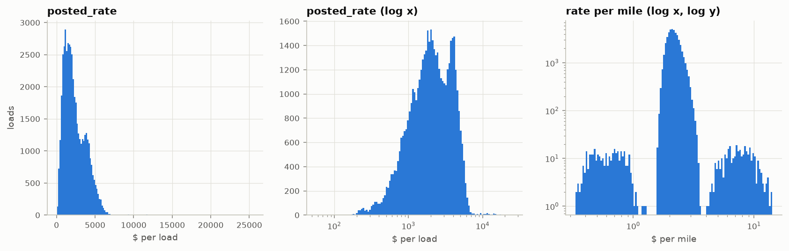
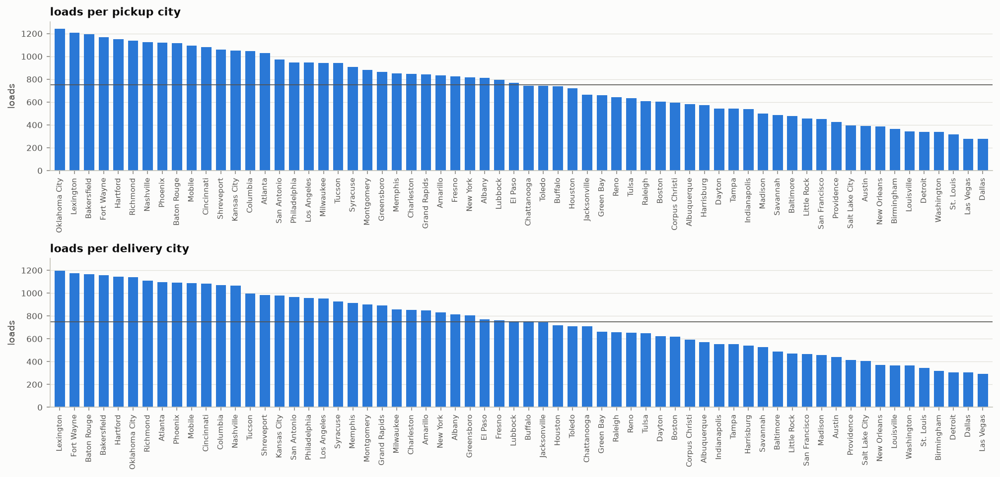

# 02 · Univariate distributions (train)

Goal: understand each column on its own before relating them. Train set only; train-vs-validation comparisons live in step 06.

## 1. Target

*Left: raw rate is right-skewed with a long tail. Middle: on a log axis it is close to symmetric → multiplicative structure. Right: rate per mile is tightly concentrated, with isolated tails far from the bulk (log y makes the few hundred tail rows visible).*

| quantile | posted_rate ($) | rate per mile ($) |
| --- | --- | --- |
| p0 | 57.220 | 0.334 |
| p0.1 | 200.3 | 0.437 |
| p1 | 327.2 | 1.674 |
| p5 | 599.7 | 1.808 |
| p25 | 1,252 | 1.987 |
| p50 | 2,031 | 2.145 |
| p75 | 3,331 | 2.343 |
| p95 | 4,954 | 2.736 |
| p99 | 5,973 | 3.177 |
| p99.9 | 12,855 | 10.069 |
| p100 | 25,533 | 14.125 |

- Skewness: posted_rate 1.90, log(posted_rate) -0.49, rate per mile 8.72.
- Rate per mile p1–p99 is 1.67–3.18, but min/max are 0.33/14.13: far tails that look like corrupted labels, not market moves.

## 2. Inputs

*Distance is spread from 70 to 3,400 miles. Weight has a negative mirror image (orange) and a spike at the 47,500 lb cap. market_index is multi-modal (a time-driven series, see step 05). quote_signal looks like a rate-per-mile number. Equipment is imbalanced toward Dry Van.*

| index | missing | mean | std | min | p1 | median | p99 | max | skew |
| --- | --- | --- | --- | --- | --- | --- | --- | --- | --- |
| distance | 0 | 1,136 | 728.6 | 70.000 | 121.9 | 953.3 | 3,029 | 3,440 | 0.766 |
| weight | 300 | 31,029 | 9,391 | -47,500 | 9,802 | 31,436 | 47,500 | 47,500 | -1.910 |
| market_index | 374 | 1.083 | 0.168 | 0.676 | 0.783 | 1.056 | 1.407 | 1.468 | 0.214 |
| quote_signal | 0 | 2.062 | 0.291 | 0.692 | 1.305 | 2.056 | 2.884 | 3.610 | 0.172 |
| posted_rate | 0 | 2,374 | 1,486 | 57.220 | 327.2 | 2,031 | 5,973 | 25,533 | 1.902 |
| rpm | 0 | 2.215 | 0.584 | 0.334 | 1.674 | 2.145 | 3.177 | 14.125 | 8.720 |

## 3. Cities

*Loads per city (line = mean). Volume is fairly even across the 64 train cities.*

pickup: min 276 (Dallas), max 1242 (Oklahoma City), coefficient of variation 0.37.

delivery: min 292 (Las Vegas), max 1197 (Lexington), coefficient of variation 0.36.
