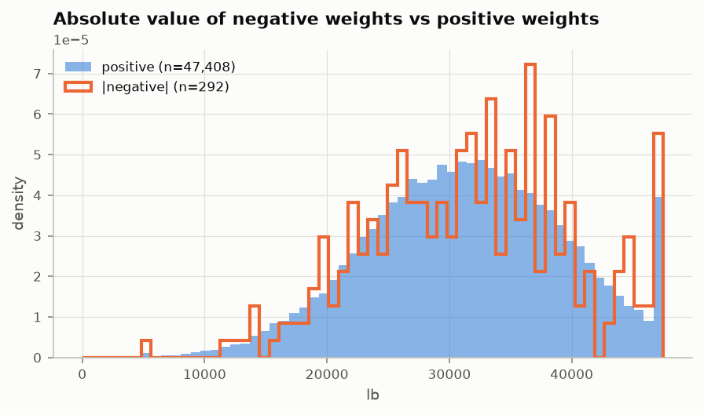
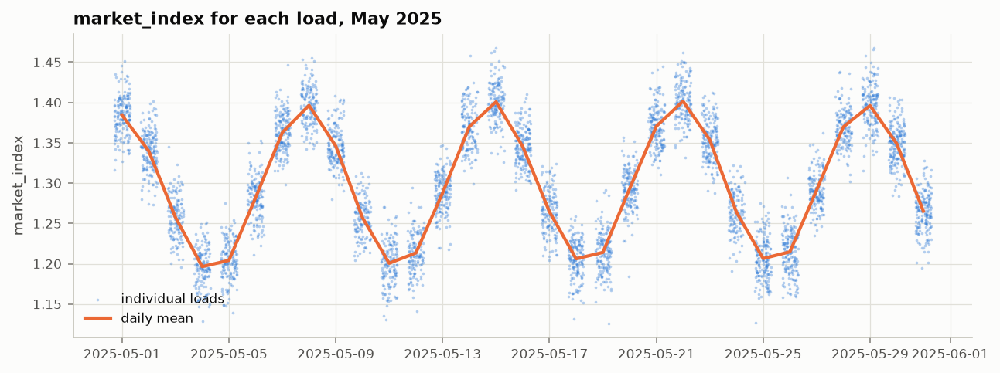
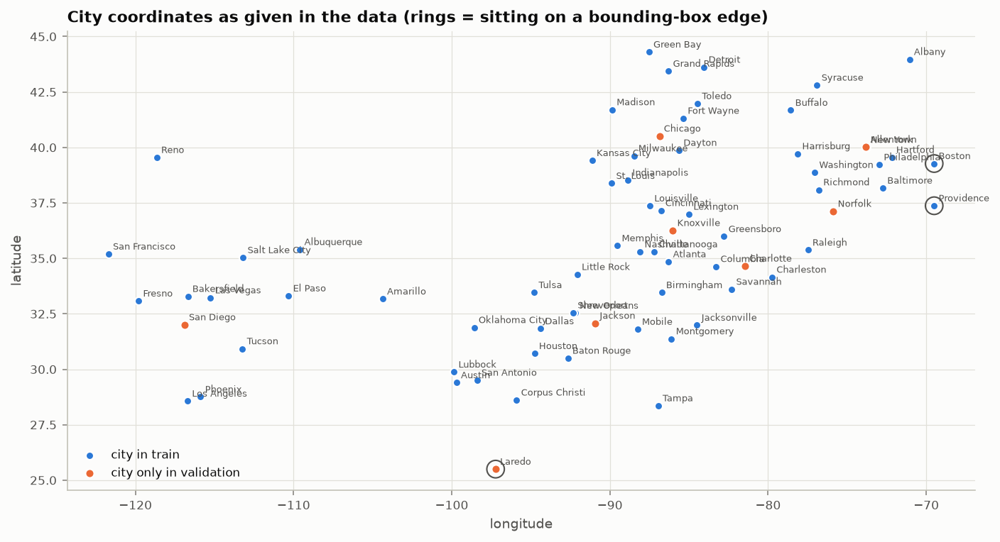
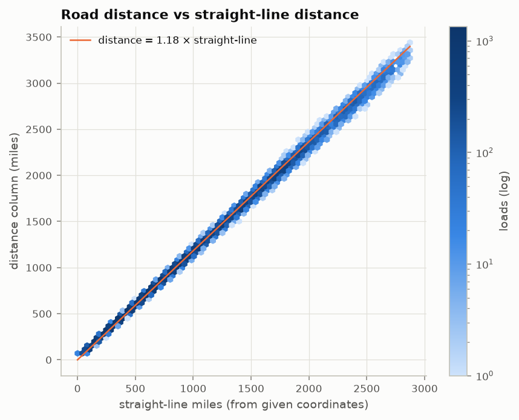
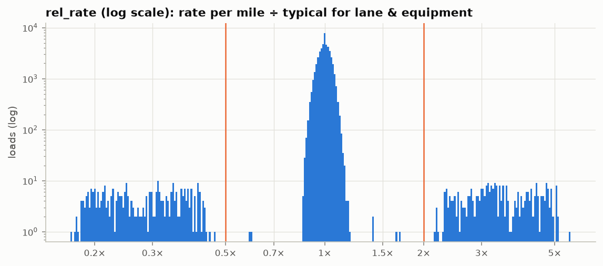
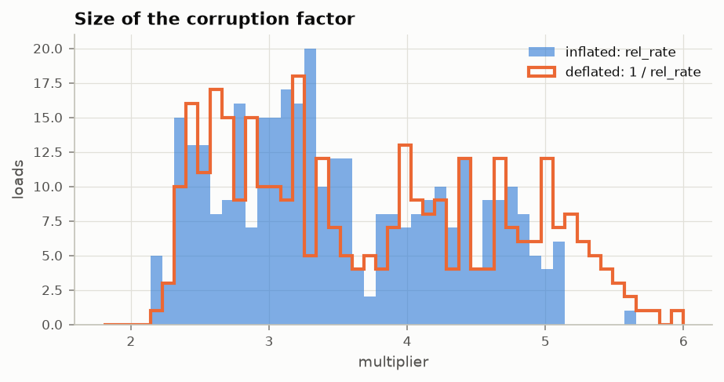

# 03 · Data quality deep-dive

Each issue gets a size, a mechanism hypothesis and evidence. `rel_rate` = rate per mile ÷ typical rate per mile for the same lane and equipment (equipment premiums used: Dry Van 1.000, Reefer 1.130, Flatbed 1.085). rel_rate ≈ 1 means a normal label.

## A. Weight

| index | train | validation |
| --- | --- | --- |
| rows | 48,000 | 12,000 |
| missing | 300 | 165 |
| negative | 292 | 145 |
| exactly 47,500 | 1,191 | 297 |
| exactly -47,500 | 13 | 4 |

### A1. Negative weights: sign flip?

| index | |negative weights| | positive weights |
| --- | --- | --- |
| p5 | 18,966 | 18,004 |
| p25 | 25,928 | 25,922 |
| p50 | 31,822 | 31,494 |
| p75 | 37,284 | 37,063 |
| p95 | 46,070 | 44,962 |

*If negatives are sign flips, |negative| should have the same shape as positives.*

KS test |negative| vs positive: D = 0.041, p = 0.70 (no evidence the distributions differ).

### A2. Label behaviour by weight status

If the weight field is broken but the load is normal, its label should look like any other load's.

| index | rows | median rel_rate | rel_rate IQR | outlier % |
| --- | --- | --- | --- | --- |
| capped | 1,191 | 1.030 | 0.051 | 1.343 |
| missing | 300 | 1.000 | 0.053 | 1.000 |
| negative | 292 | 1.000 | 0.057 | 3.082 |
| normal | 46,217 | 1.000 | 0.054 | 1.398 |

### A3. Pile-ups at both ends: is weight clipped?

| end | rows exactly at value | observed share % | normal-fit tail beyond value % | next distinct value |
| --- | --- | --- | --- | --- |
| floor 5,000 | 32 | 0.07 | 0.05 | 5,122 |
| cap 47,500 | 1,204 | 2.51 | 2.13 | 47,495 |

A robust normal fit to the unclipped weights (median 31,245, sd 8,014) predicts roughly the tail mass that piles up at each end, so weight was **clipped to [5,000, 47,500]**: a capped row's true weight is 'at least 47,500'. Do capped rows price like the heaviest loads?

| weight | rows | median rel_rate | rel_rate IQR | outlier % |
| --- | --- | --- | --- | --- |
| (30000.0, 35000.0] | 11,229 | 1.004 | 0.044 | 1.238 |
| (35000.0, 40000.0] | 8,902 | 1.020 | 0.047 | 1.292 |
| (40000.0, 42500.0] | 2,895 | 1.026 | 0.053 | 1.589 |
| (42500.0, 45000.0] | 1,855 | 1.028 | 0.055 | 1.402 |
| (45000.0, 47499.0] | 1,160 | 1.030 | 0.054 | 1.466 |
| (47499.0, 47500.0] | 1,204 | 1.030 | 0.051 | 1.329 |
| nan | 4 | 0.996 | 0.027 | 0.000 |

The weight effect flattens above ~42,500 lb, so the cap costs little information.

### A4. Missing weight: random?

Missing-weight share by month ranges 0.42%–0.76%; label behaviour of missing rows is in the A2 table.

## B. market_index: a per-date value?

| index | train | validation |
| --- | --- | --- |
| mean within-date std | 0.0249 | 0.0248 |
| std of daily means | 0.1665 | 0.0711 |
| share of variance explained by date | 0.9781 | 0.8888 |
| leave-one-out daily-mean imputation MAE | 0.0200 | 0.0198 |
| missing | 374.0 | 249.0 |

*Loads on the same day share almost the same market_index; the daily mean carries the signal.*

| market_index | rows | median rel_rate | rel_rate IQR | outlier % |
| --- | --- | --- | --- | --- |
| missing | 374 | 1.000 | 0.054 | 1.604 |
| present | 47,626 | 1.000 | 0.054 | 1.403 |

## C. Coordinates and distance

*Coordinates are only roughly geographic (e.g. Boston/Providence pinned at lon −69.5, Laredo at lat 25.5).*

Cities sitting exactly on an extreme coordinate:

| city | lat | lon |
| --- | --- | --- |
| Boston | 39.27463 | -69.50000 |
| Laredo | 25.50000 | -97.22681 |
| Providence | 37.37287 | -69.50000 |

### C1. Road distance vs straight-line distance

| index | distance / straight-line |
| --- | --- |
| count | 60,000 |
| mean | 1.199 |
| std | 0.570 |
| min | 1.058 |
| 1% | 1.129 |
| 5% | 1.143 |
| 50% | 1.182 |
| 95% | 1.274 |
| 99% | 1.406 |
| max | 78.500 |

Lanes with the most extreme ratios. The top ones sit on the 70-mile distance floor (C3) while their coordinates are almost on top of each other; the lowest ratios are still ≥ 1.06, physically plausible.

| pickup | delivery | circuity | distance | straight_line | n |
| --- | --- | --- | --- | --- | --- |
| Allentown | New York | 78.50 | 70.00 | 0.89 | 1 |
| New York | Allentown | 78.50 | 70.00 | 0.89 | 2 |
| New Orleans | Shreveport | 9.63 | 70.00 | 7.27 | 9 |
| Shreveport | New Orleans | 9.63 | 70.00 | 7.27 | 11 |
| Austin | Lubbock | 2.03 | 72.12 | 34.46 | 8 |
| Lubbock | Austin | 2.03 | 70.00 | 34.46 | 7 |
| New York | Laredo | 1.11 | 1,871 | 1,682 | 1 |
| Washington | San Diego | 1.11 | 2,531 | 2,274 | 1 |
| Albuquerque | Birmingham | 1.12 | 1,464 | 1,307 | 1 |
| Charlotte | Corpus Christi | 1.13 | 1,063 | 944.3 | 1 |

*The distance column is consistent with a ~1.18 road-circuity factor; deviations come from distorted coordinates.*

### C2. Distance noise within a lane

Within a lane, distance varies with median CV 1.8% (p95 3.9%): per-load route noise, not a different lane.

| pickup | delivery | mean | std | min | max | count | cv % |
| --- | --- | --- | --- | --- | --- | --- | --- |
| Chattanooga | Atlanta | 88.100 | 10.300 | 70.000 | 109.6 | 28 | 11.600 |
| Fort Wayne | Toledo | 96.100 | 9.800 | 79.200 | 115.4 | 22 | 10.200 |
| Las Vegas | Bakersfield | 114.2 | 10.200 | 95.700 | 134.9 | 11 | 9.000 |
| Memphis | Nashville | 118.5 | 8.900 | 94.500 | 138.4 | 24 | 7.500 |
| San Antonio | Austin | 107.9 | 11.500 | 83.000 | 124.1 | 17 | 10.600 |
| San Antonio | Lubbock | 121.2 | 9.900 | 98.600 | 138.6 | 15 | 8.200 |
| Toledo | Fort Wayne | 96.400 | 10.400 | 76.200 | 114.8 | 16 | 10.800 |

Symmetry: median |d(A→B) − d(B→A)| / d = 0.57% across 4,554 lane pairs.

### C3. A floor on distance

| index | train | validation |
| --- | --- | --- |
| rows with distance == 70.0 | 48 | 21 |
| next most common lowest value count | 2 | 1 |
| lanes with at least one row at 70.0 | 12 | 10 |

70.0 appears dozens of times while every other value appears a handful of times: distance is **floored at 70 miles**. For those short lanes the true distance is 'at most 70', so rate per mile there is inflated.

## D. Label outliers

*A dense core around 1× and two separated clusters. Orange lines = thresholds 0.5× / 2.0×, placed in the empty gaps, so the exact choice barely matters.*

- Inflated labels (> 2.0×): 337 (0.70%), range 2.17×–5.59×.
- Deflated labels (< 0.5×): 337 (0.70%), range 0.17×–0.46× (i.e. ÷2.2 to ÷5.9).
- Core (non-outlier) rel_rate: p0.1–p99.9 = 0.877–1.138, median absolute deviation from 1 = 2.7% (this includes real effects such as weight and market, so pure label noise is smaller).
- Rows in the gap zones (1.25×, 2×] and [0.5×, 0.8×): 4 and 2: the clusters are genuinely separate.

*Inflated and deflated labels share the same factor range (~2–5.5×): looks like random ×k or ÷k corruption.*

### D1. Are outliers concentrated anywhere? (chi-square test of independence)

| factor | levels | outlier % min | outlier % max | chi-square p |
| --- | --- | --- | --- | --- |
| equipment | 3 | 1.349 | 1.494 | 0.487 |
| month | 10 | 1.242 | 1.648 | 0.715 |
| day of week | 7 | 1.211 | 1.586 | 0.543 |
| distance quintile | 5 | 1.229 | 1.583 | 0.297 |
| weight status | 4 | 1.000 | 3.082 | 0.096 |
| market_index missing | 2 | 1.403 | 1.604 | 0.913 |
| pickup city | 64 | 0.000 | 3.264 | 0.748 |

High p-values mean the outliers are scattered at random rather than tied to a segment.

### D2. How much do 1.3% of rows matter?

| index | share of rows | share of total absolute error | share of total squared error |
| --- | --- | --- | --- |
| outlier rows | 0.014 | 0.401 | 0.962 |

Error of the in-sample 'lane typical rate' reference itself (not a model, just a yardstick):

| index | MAE ($) | RMSE ($) | MAPE (%) | median APE (%) | R2 |
| --- | --- | --- | --- | --- | --- |
| all rows | 125.5 | 597.4 | 5.57 | 2.72 | 0.84 |
| non-outlier rows | 76.21 | 117.1 | 3.22 | 2.67 | 0.99 |

A squared-error loss would spend most of its effort on these few corrupted rows → drop them from training and/or use a robust loss.

## Summary of issues

| issue | train | validation | evidence | candidate handling |
| --- | --- | --- | --- | --- |
| negative weight | 292 | 145 | |neg| ≈ positives (KS D=0.041); labels normal | take abs() |
| weight clipped to [5,000, 47,500] | 1,236 | 308 | pile-ups ≈ normal-fit tail mass | keep value (effect flat at the top); optional is_capped flag |
| missing weight | 300 | 165 | labels normal, no time pattern | impute (median per equipment) + flag |
| missing market_index | 374 | 249 | date explains 98% of its variance | impute with same-date mean |
| distance floored at 70 mi | 48 | 21 | pile-up at exactly 70.0 | keep; short-haul fixed-cost structure absorbs it |
| clipped coordinates | 2,062 | 675 | cities pinned at round extreme lat/lon | trust `distance`; use coords only as coarse region features |
| distance noise within lane |  |  | median CV 1.8% | use distance as-is (it is what the load ran) |
| corrupted labels (×/÷ 2–5.5) | 674 | unknown | isolated clusters, random across segments | drop from training; robust loss; check metric choice |

Validation shows the same issues at similar or higher rates (tables A and B), so every fix must be a function applied at prediction time, not a one-off edit of the training file.
