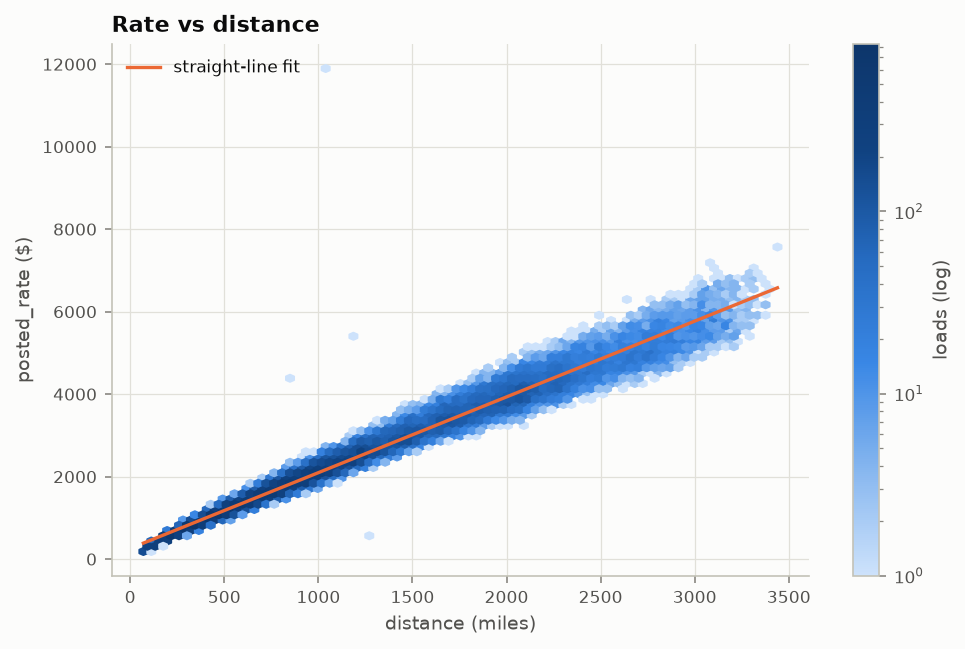
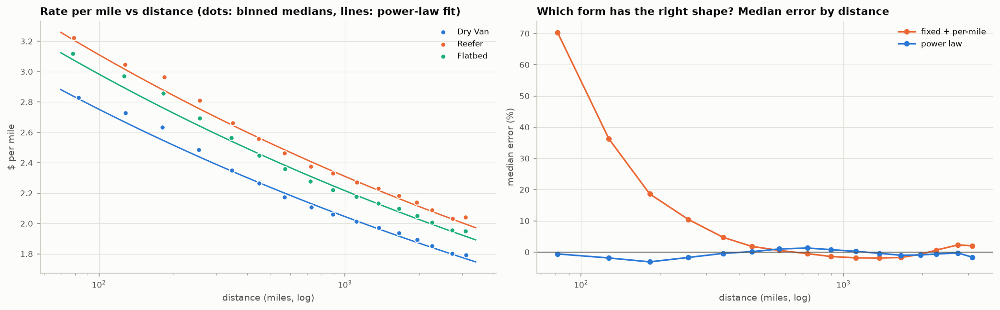
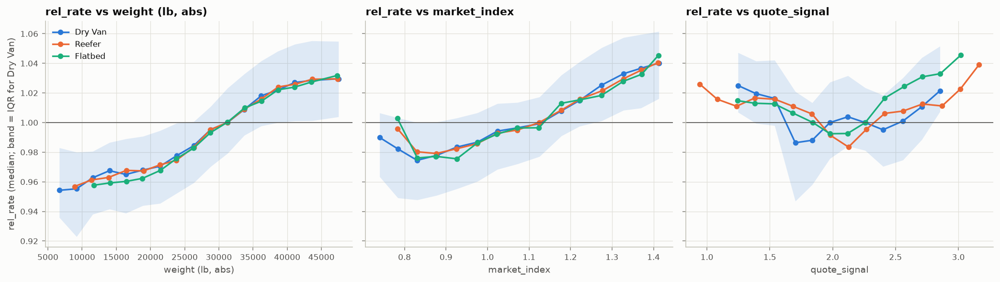
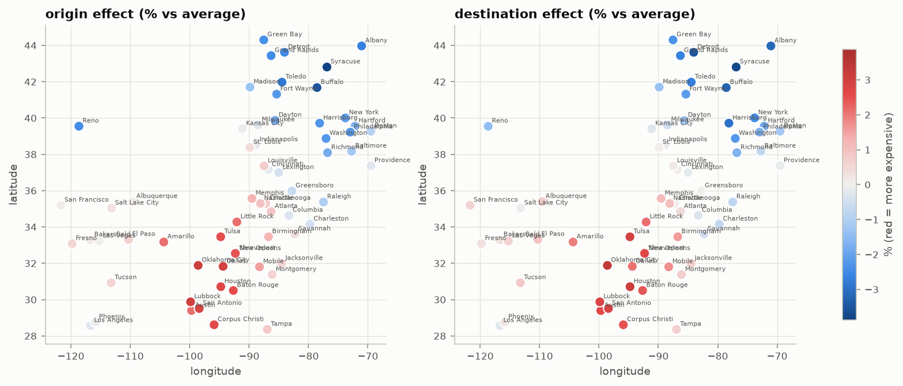

# 04 · What drives the rate

Train rows without corrupted labels (n = 47,326). We start with the most obvious driver and add one factor at a time, measuring each on the lane-normalised rate (`rel_rate`) so factors don't get confused with lane mix.

## 1. Distance alone

| in-sample fit (descriptive only) | MAE ($) | RMSE ($) | MAPE (%) | median APE (%) | R2 |
| --- | --- | --- | --- | --- | --- |
| rate = 259 + 1.837·distance | 147.2 | 207.0 | 7.40 | 5.77 | 0.98 |
| rate = 5.22·distance^0.871 | 140.0 | 201.8 | 6.04 | 5.34 | 0.98 |

*Distance alone gives R² = 0.977, yet MAPE is still 7.4%: the vertical spread at a given distance is what everything else has to explain.*

## 2. Shape of the distance effect, per equipment

| equipment | fixed $/load (a) | $/mile (b) | MAPE % fixed+per-mile | power-law exponent | MAPE % power law |
| --- | --- | --- | --- | --- | --- |
| Dry Van | 247.3 | 1.754 | 5.559 | 0.871 | 4.029 |
| Reefer | 281.5 | 1.979 | 5.670 | 0.871 | 4.138 |
| Flatbed | 265.0 | 1.903 | 5.697 | 0.871 | 4.355 |

All equipment together: fixed+per-mile MAPE 5.61%, power law MAPE 4.12%. Power-law exponents per equipment: 0.871, 0.871, 0.871. Both forms say rate per mile falls with distance (a fixed cost spread over more miles); the residual plot shows which form has the right shape.

*Left: rate per mile falls with distance in the same shape for every equipment. Right: a correct functional form leaves a flat error line; a systematic curve means the form is wrong and a model would have to learn the correction.*

## 3. Equipment premium, measured within the same lane

| equipment vs Dry Van | lanes | median ratio | p25 | p75 |
| --- | --- | --- | --- | --- |
| Reefer | 3,483 | 1.130 | 1.103 | 1.158 |
| Flatbed | 3,242 | 1.084 | 1.056 | 1.114 |

Premium by lane distance. A constant ratio means the premium is **multiplicative** (a % of the rate); an additive $/mile premium would make the ratio drift with distance.

| lane distance (mi) | Reefer | Flatbed |
| --- | --- | --- |
| (69, 300] | 1.129 | 1.084 |
| (300, 600] | 1.131 | 1.086 |
| (600, 1000] | 1.131 | 1.084 |
| (1000, 1500] | 1.130 | 1.083 |
| (1500, 2000] | 1.128 | 1.087 |
| (2000, 3500] | 1.129 | 1.082 |

## 4. Weight, market_index and quote_signal (on the lane-normalised rate)

*Heavier loads and stronger markets cost more, in the same way for every equipment type. quote_signal shows almost no relationship overall (but see step 06).*

| factor | all | Dry Van | Reefer | Flatbed | Spearman with rel_rate |
| --- | --- | --- | --- | --- | --- |
| weight (log-log elasticity) | 0.076 | 0.075 | 0.075 | 0.078 | 0.533 |
| market_index (log-log elasticity) | 0.127 | 0.130 | 0.124 | 0.125 | 0.473 |
| quote_signal (slope of log rel_rate) | 0.010 | 0.016 | -0.001 | 0.021 | 0.053 |

## 5. Geography: what is left at lane level?

Lane premium = log(lane's typical Dry-Van-equivalent rate per mile) − log(what a flexible distance curve predicts). Lanes with ≥ 3 clean loads: 3,822. Correlation of premium with log distance: -0.000 (≈ 0 confirms the curve removed distance).

| lane-level variation | std (%) |
| --- | --- |
| observed lane premium | 3.27 |
| expected from sampling noise alone | 1.80 |
| left after origin + destination effects | 2.06 |

An additive origin + destination model explains 65% of lane-premium variance. The closer the leftover is to the sampling-noise line, the less a model needs lane identity, which matters because 12% of validation rows are on lanes never seen in training.

Correlation between a city's origin effect and its destination effect: 0.97. Strongly negative would mean headhaul/backhaul imbalance; strongly positive means a regional price level that applies whichever way the truck goes.

Most and least expensive origins:

| index | origin effect % | destination effect % |
| --- | --- | --- |
| Oklahoma City | 3.09 | 3.28 |
| Lubbock | 3.00 | 2.80 |
| New Orleans | 2.98 | 1.84 |
| Dallas | 2.94 | 2.07 |
| San Antonio | 2.81 | 2.76 |
| Houston | 2.69 | 3.09 |
| Syracuse | -3.87 | -3.74 |
| Buffalo | -3.50 | -3.22 |
| Toledo | -2.87 | -2.71 |
| Albany | -2.66 | -3.12 |
| Detroit | -2.49 | -3.47 |
| Reno | -2.46 | -1.42 |

Are city effects spatially smooth? If neighbours look alike, unseen cities can borrow from nearby ones.

| index | corr with 3 nearest cities' mean | corr with lon | corr with lat | std (%) |
| --- | --- | --- | --- | --- |
| origin | 0.94 | -0.39 | -0.82 | 1.81 |
| destination | 0.94 | -0.45 | -0.84 | 1.81 |

*City effects on rate after distance and equipment. Spatial clustering means geography (lat/lon) can stand in for city identity.*

Direction matters? Correlation of premium(A→B) with premium(B→A) over 3,696 directed lanes: 0.61.

## Summary: effect sizes, ranked by how much they move the rate

| driver | effect size |
| --- | --- |
| distance (p5→p95, rate per mile) | -26% per mile (237→2564 mi) |
| equipment: Reefer | +13.0% vs Dry Van |
| equipment: Flatbed | +8.5% vs Dry Van |
| weight (p5→p95) | +6.9% (17,964→43,305 lb) |
| market_index (p5→p95) | +6.4% (0.84→1.37) |
| lane premium (std across lanes) | ±3.3% (noise alone ±1.8%) |
| origin city (std) | ±1.8% |
| destination city (std) | ±1.8% |
