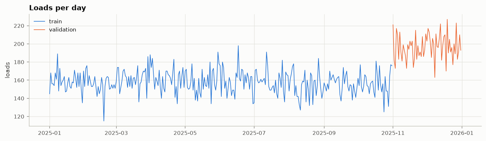
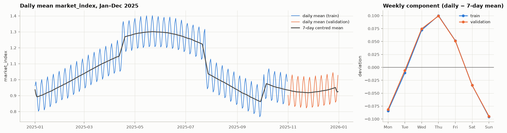
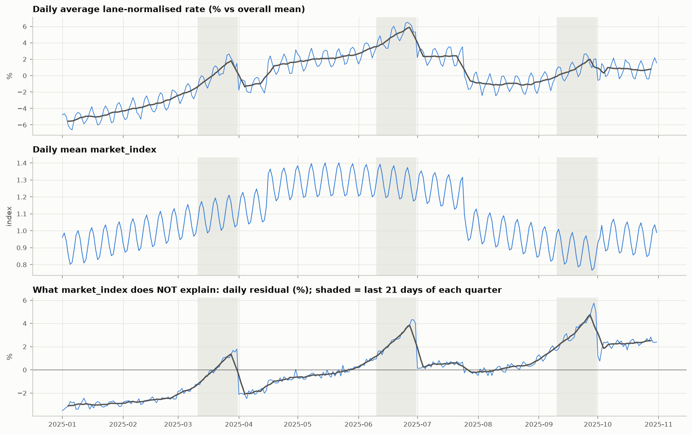
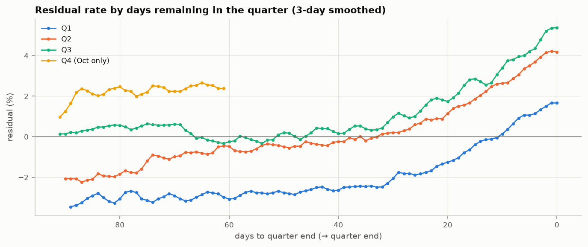

# 05 · Time effects

Validation is Nov–Dec (future) and the December chart changes only the date, so every time effect matters. Rate analyses use clean train rows and `rel_rate` (lane- and equipment-normalised).

## 1. Volume over time

*Validation days carry ~25% more loads than train days; otherwise volume is flat with no gaps.*

| split | Mon | Tue | Wed | Thu | Fri | Sat | Sun |
| --- | --- | --- | --- | --- | --- | --- | --- |
| train | 157.4 | 156.7 | 159.2 | 157.6 | 158.5 | 157.4 | 158.3 |
| validation | 189.2 | 205.1 | 194.1 | 189.5 | 202.5 | 202.6 | 193.9 |

## 2. market_index as a time series

*market_index = a slow seasonal level (peak May–Jun) plus a strong weekly cycle with the same phase in train and validation.*

| month | mean | weekly_amplitude | peak_day | trough_day |
| --- | --- | --- | --- | --- |
| 1 | 0.927 | 0.189 | Thu | Sun |
| 2 | 0.997 | 0.195 | Thu | Sun |
| 3 | 1.074 | 0.196 | Thu | Sun |
| 4 | 1.209 | 0.207 | Thu | Sun |
| 5 | 1.300 | 0.194 | Thu | Sun |
| 6 | 1.280 | 0.193 | Thu | Sun |
| 7 | 1.200 | 0.215 | Thu | Sun |
| 8 | 0.980 | 0.196 | Thu | Sun |
| 9 | 0.893 | 0.197 | Thu | Sun |
| 10 | 0.957 | 0.179 | Thu | Sun |
| 11 | 0.919 | 0.195 | Thu | Sun |
| 12 | 0.934 | 0.193 | Thu | Sun |

## 3. Does market_index explain the rate's movement over time?

Model: log(rel_rate) = a + 0.127·log(daily market_index) + 0.074·log(weight). Daily market_index explains **48%** of the day-to-day variance of the daily average rate.

Per-load vs daily: splitting market_index into the day's mean and the load's deviation from it gives coefficients 0.127 (daily level) and 0.110 (load deviation). If the deviation's coefficient is close to the daily one, the per-load value carries real information; if near 0, it is noise around the daily level.

*Top: the rate moves with the market. Bottom: after removing market_index, a repeating ramp into each quarter end and a slow upward drift remain.*

## 4. Quarter-end effect

*Each completed quarter shows the same shape: flat, then a ramp over roughly the last three weeks, then a reset when the new quarter starts.*

| quarter | first 14 days % | days 21–50 before end % | last 14 days % | ramp (last14 − mid) % |
| --- | --- | --- | --- | --- |
| Q1 | -3.03 | -2.29 | 0.81 | 3.09 |
| Q2 | -1.97 | 0.04 | 3.26 | 3.22 |
| Q3 | 0.36 | 0.65 | 4.02 | 3.37 |
| Q4 | 2.04 |  |  |  |

| quarter end | last 7 days % | first 7 days of next quarter % | drop % |
| --- | --- | --- | --- |
| 2025-03-31 | 1.36 | -2.09 | -3.45 |
| 2025-06-30 | 3.86 | 0.25 | -3.61 |
| 2025-09-30 | 4.75 | 1.85 | -2.90 |

Averaged over Q1–Q3, relative to days 30–60 before the end, the residual first exceeds +1% (3-day smoothed) about **24 days** before quarter end and peaks at +4.8%.

## 5. Day of week

| day | raw rate (% vs mean) | after market_index (%) |
| --- | --- | --- |
| Mon | -0.80 | 0.18 |
| Tue | -0.13 | -0.04 |
| Wed | 0.69 | -0.16 |
| Thu | 0.99 | -0.12 |
| Fri | 0.54 | -0.10 |
| Sat | -0.31 | 0.11 |
| Sun | -1.03 | 0.14 |

Raw weekday spread 2.01 pts; after market_index 0.34 pts. If the second is ~0, the weekly price cycle is carried entirely by market_index.

## 6. Holidays

| holiday | date | day % | ±2 days % | surrounding 4 weeks % | difference % |
| --- | --- | --- | --- | --- | --- |
| New Year's Day | 2025-01-01 | -3.51 | -3.38 | -2.98 | -0.40 |
| MLK Day | 2025-01-20 | -2.82 | -2.96 | -2.95 | -0.01 |
| Presidents Day | 2025-02-17 | -2.61 | -2.56 | -2.52 | -0.04 |
| Memorial Day | 2025-05-26 | -0.14 | -0.02 | 0.07 | -0.09 |
| Juneteenth | 2025-06-19 | 2.61 | 2.54 | 2.03 | 0.51 |
| Independence Day | 2025-07-04 | 0.34 | 0.22 | 1.85 | -1.63 |
| Labor Day | 2025-09-01 | 1.29 | 0.95 | 1.17 | -0.22 |
| Columbus Day | 2025-10-13 | 2.48 | 2.33 | 2.42 | -0.10 |

Daily residual standard deviation for reference: 2.03%. Differences well inside that are noise.

## 7. Slow drift

| month | n | median_rpm | market_index | raw_rate_pct | residual_pct |
| --- | --- | --- | --- | --- | --- |
| 1 | 4,837 | 2.029 | 0.927 | -4.938 | -3.015 |
| 2 | 4,280 | 2.061 | 0.996 | -3.584 | -2.623 |
| 3 | 4,965 | 2.140 | 1.073 | -0.366 | -0.348 |
| 4 | 4,753 | 2.147 | 1.207 | 0.113 | -1.397 |
| 5 | 4,852 | 2.191 | 1.301 | 2.164 | -0.327 |
| 6 | 4,721 | 2.247 | 1.280 | 4.313 | 2.077 |
| 7 | 4,848 | 2.187 | 1.201 | 1.738 | 0.314 |
| 8 | 4,691 | 2.121 | 0.982 | -1.045 | 0.172 |
| 9 | 4,606 | 2.159 | 0.893 | 0.534 | 2.828 |
| 10 | 4,773 | 2.164 | 0.957 | 0.767 | 2.221 |

Linear drift of the residual: +0.58% per 30 days using all days, +0.54% per 30 days excluding quarter-end ramps and quarter starts. A drift that survives the exclusion is a genuine trend, which a tree model cannot extrapolate into Nov–Dec on its own.
