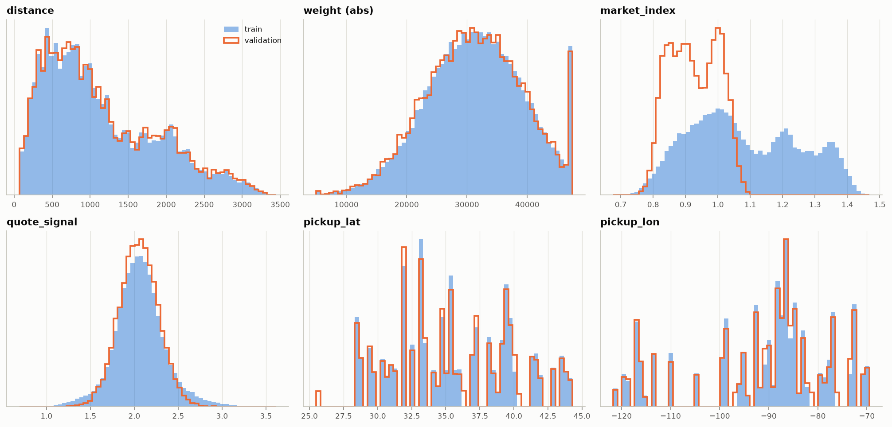
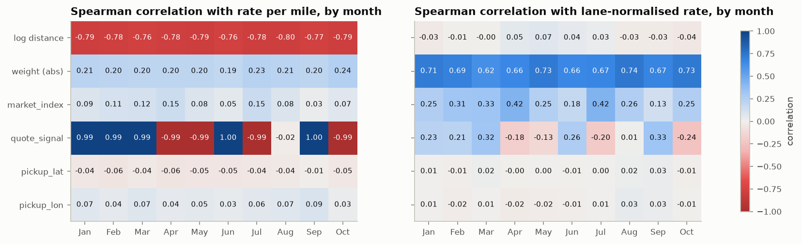
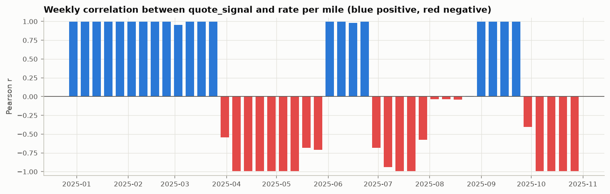
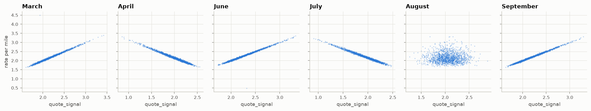

# 06 · Train vs validation: drift and leakage

Validation (Nov–Dec) is a future period. A model only transfers if (a) validation inputs sit inside what it saw, and (b) each input's relationship with the rate is stable over time.

## 1. Numeric inputs: train vs validation

*Distance, weight and geography are stable. market_index and quote_signal are narrower in validation (Nov–Dec is a quiet, single-season slice).*

| index | train mean | val mean | train std | val std | train p1–p99 | val p1–p99 | val share inside train min–max % | KS distance |
| --- | --- | --- | --- | --- | --- | --- | --- | --- |
| distance | 1,136 | 1,142 | 728.6 | 732.3 | 122–3.03e+03 | 119–3.01e+03 | 100.0 | 0.007 |
| weight (abs) | 31,417 | 31,283 | 7,997 | 7,988 | 1.25e+04–4.75e+04 | 1.25e+04–4.75e+04 | 100.0 | 0.010 |
| market_index | 1.083 | 0.927 | 0.168 | 0.074 | 0.783–1.41 | 0.791–1.07 | 100.0 | 0.483 |
| quote_signal | 2.062 | 2.051 | 0.291 | 0.220 | 1.3–2.88 | 1.54–2.56 | 100.0 | 0.046 |
| pickup_lat | 35.648 | 35.574 | 4.315 | 4.367 | 28.4–44.3 | 28.4–44.3 | 99.258 | 0.012 |
| pickup_lon | -90.929 | -90.725 | 13.482 | 13.412 | -120–-69.5 | -120–-69.5 | 100.0 | 0.012 |

KS distance: 0 = identical distributions, 1 = no overlap. Values above ~0.1 indicate a shift worth checking.

market_index by month: validation's level is low but matches Jan, Aug–Oct, which are in training.

| month | mean | min | max |
| --- | --- | --- | --- |
| 1 | 0.927 | 0.733 | 1.115 |
| 2 | 0.996 | 0.802 | 1.188 |
| 3 | 1.073 | 0.852 | 1.270 |
| 4 | 1.208 | 0.949 | 1.438 |
| 5 | 1.301 | 1.126 | 1.468 |
| 6 | 1.280 | 1.085 | 1.461 |
| 7 | 1.201 | 0.877 | 1.416 |
| 8 | 0.981 | 0.763 | 1.178 |
| 9 | 0.893 | 0.676 | 1.091 |
| 10 | 0.958 | 0.787 | 1.141 |
| 11 | 0.919 | 0.724 | 1.088 |
| 12 | 0.935 | 0.770 | 1.099 |

## 2. Cities and lanes

| validation coverage | share of validation rows % |
| --- | --- |
| touch a city never seen in train | 12.1 |
| lane never seen in train | 12.2 |
|   …of which both cities are known | 0.1 |
| lane seen 1–4 times | 4.7 |
| lane seen ≥ 5 times | 83.1 |

| new city | as pickup | as delivery |
| --- | --- | --- |
| Allentown | 90 | 81 |
| Charlotte | 88 | 88 |
| Chicago | 75 | 104 |
| Jackson | 118 | 75 |
| Knoxville | 93 | 77 |
| Laredo | 89 | 106 |
| Norfolk | 88 | 84 |
| San Diego | 84 | 107 |

Equipment mix is unchanged: Dry Van 56.7% → 56.5%, Reefer 25.1% → 25.4%, Flatbed 18.2% → 18.1%.

## 3. Is each feature's relationship with the rate stable over time?

*Every feature keeps its sign month after month, except quote_signal, which swings between strongly positive and strongly negative.*

| index | std of monthly corr (rpm) | std of monthly corr (rel_rate) | sign flips (rpm) |
| --- | --- | --- | --- |
| log distance | 0.014 | 0.039 | 0 |
| weight (abs) | 0.016 | 0.038 | 0 |
| market_index | 0.039 | 0.095 | 0 |
| quote_signal | 0.988 | 0.233 | 5 |
| pickup_lat | 0.015 | 0.013 | 0 |
| pickup_lon | 0.019 | 0.020 | 0 |

## 4. quote_signal deep-dive

*Within a regime quote_signal is almost a copy of the target (|r| up to 1.0); the sign flips at regime boundaries and it carries nothing in August.*

*quote_signal vs rate per mile in different months: rising, falling, rising, falling, flat, rising.*

### What does quote_signal do in validation? A target-free proxy

We cannot correlate with the target in validation, but in train, wherever quote_signal tracks the rate it must also track log distance (the dominant driver of rate per mile). So corr(quote_signal, log distance) is a proxy for its relationship with the target that we *can* compute in validation.

| month | corr(quote_signal, log distance) | corr(quote_signal, rate per mile) | split |
| --- | --- | --- | --- |
| 1 | -0.820 | 0.996 | train |
| 2 | -0.816 | 0.996 | train |
| 3 | -0.794 | 0.988 | train |
| 4 | 0.809 | -0.993 | train |
| 5 | 0.825 | -0.892 | train |
| 6 | -0.798 | 0.993 | train |
| 7 | 0.808 | -0.980 | train |
| 8 | 0.018 | -0.020 | train |
| 9 | -0.803 | 0.997 | train |
| 10 | 0.821 | -0.994 | train |
| 11 | 0.009 |  | validation |
| 12 | 0.013 |  | validation |

In train the proxy mirrors the target correlation month by month (with the opposite sign, because rate per mile falls with distance). In validation the proxy is ≈ 0, like August: **quote_signal carries no information about Nov–Dec rates.** A model that leans on it would score well on a random split of train and then fail on validation.

Its own distribution barely moves (train monthly std 0.22–0.29, validation 0.22–0.22), so a simple drift check would *not* catch it. Only the relationship changes.
