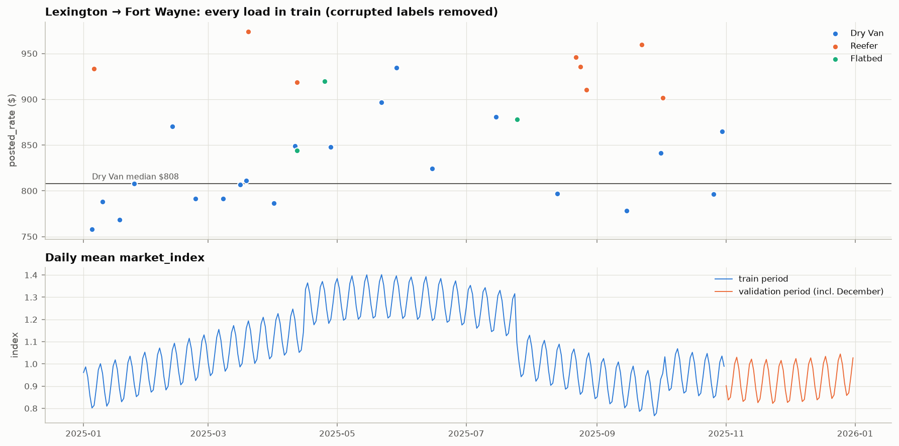
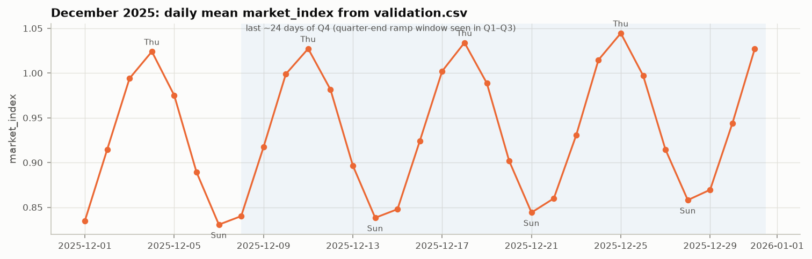

# 07 · December chart inputs

Fixed inputs: Lexington → Fort Wayne, 360 mi, Dry Van, 32,000 lb; only the date changes.

## 1. Which model inputs are available?

| input | in December file | how to obtain |
| --- | --- | --- |
| pickup, delivery, distance, equipment, weight, date | yes | given |
| pickup/delivery lat & lon | no | city lookup from train (Lexington: 36.992, -84.999; Fort Wayne: 41.316, -85.362) |
| market_index | no | daily mean from validation.csv: all 31 December dates present, ~199 loads per date |
| quote_signal | no | not needed if the feature is dropped (step 06) |

## 2. History of Lexington → Fort Wayne

| equipment | loads | median_rate | min_rate | max_rate | median_rpm | mean_distance | median_weight | outliers |
| --- | --- | --- | --- | --- | --- | --- | --- | --- |
| Dry Van | 21 | 807.9 | 757.9 | 934.4 | 2.233 | 363.8 | 26,829 | 0 |
| Reefer | 8 | 934.5 | 901.4 | 973.8 | 2.571 | 366.0 | 29,862 | 0 |
| Flatbed | 3 | 877.8 | 844.1 | 919.8 | 2.475 | 356.8 | 24,941 | 0 |

- Reverse lane Fort Wayne → Lexington: 35 loads in train, median Dry Van rate $849.
- Lane distance in train: mean 363.7, range 346.3–384.5 (chart fixes 360).
- Dry Van weights in train: 16,195–41,021 lb (chart fixes 32,000).
- Validation also has 12 loads on this lane (inputs only).

*The lane's Dry Van rate moves with the market. December's market sits at a level the lane has already seen (Jan, Sep–Oct).*

## 3. December: calendar and market context

| date | dow | days_to_quarter_end | loads | market_index | market_index_std | quote_signal | holiday |
| --- | --- | --- | --- | --- | --- | --- | --- |
| 2025-12-01 | Mon | 30 | 203 | 0.835 | 0.025 | 2.052 |  |
| 2025-12-02 | Tue | 29 | 217 | 0.915 | 0.026 | 2.034 |  |
| 2025-12-03 | Wed | 28 | 213 | 0.994 | 0.023 | 2.053 |  |
| 2025-12-04 | Thu | 27 | 202 | 1.024 | 0.023 | 2.066 |  |
| 2025-12-05 | Fri | 26 | 185 | 0.975 | 0.028 | 2.047 |  |
| 2025-12-06 | Sat | 25 | 206 | 0.889 | 0.025 | 2.025 |  |
| 2025-12-07 | Sun | 24 | 200 | 0.831 | 0.024 | 2.050 |  |
| 2025-12-08 | Mon | 23 | 163 | 0.840 | 0.025 | 2.040 |  |
| 2025-12-09 | Tue | 22 | 211 | 0.917 | 0.023 | 2.050 |  |
| 2025-12-10 | Wed | 21 | 197 | 0.999 | 0.027 | 2.048 |  |
| 2025-12-11 | Thu | 20 | 196 | 1.027 | 0.026 | 2.047 |  |
| 2025-12-12 | Fri | 19 | 206 | 0.981 | 0.023 | 2.045 |  |
| 2025-12-13 | Sat | 18 | 222 | 0.897 | 0.025 | 2.063 |  |
| 2025-12-14 | Sun | 17 | 182 | 0.838 | 0.024 | 2.057 |  |
| 2025-12-15 | Mon | 16 | 198 | 0.848 | 0.026 | 2.057 |  |
| 2025-12-16 | Tue | 15 | 208 | 0.924 | 0.024 | 2.066 |  |
| 2025-12-17 | Wed | 14 | 210 | 1.002 | 0.023 | 2.024 |  |
| 2025-12-18 | Thu | 13 | 170 | 1.034 | 0.023 | 2.046 |  |
| 2025-12-19 | Fri | 12 | 227 | 0.989 | 0.024 | 2.033 |  |
| 2025-12-20 | Sat | 11 | 190 | 0.902 | 0.027 | 2.060 |  |
| 2025-12-21 | Sun | 10 | 205 | 0.844 | 0.023 | 2.089 |  |
| 2025-12-22 | Mon | 9 | 191 | 0.860 | 0.027 | 2.024 |  |
| 2025-12-23 | Tue | 8 | 196 | 0.930 | 0.022 | 2.033 |  |
| 2025-12-24 | Wed | 7 | 177 | 1.015 | 0.025 | 2.052 |  |
| 2025-12-25 | Thu | 6 | 200 | 1.045 | 0.023 | 2.054 | Christmas |
| 2025-12-26 | Fri | 5 | 189 | 0.997 | 0.023 | 2.054 |  |
| 2025-12-27 | Sat | 4 | 223 | 0.915 | 0.023 | 2.038 |  |
| 2025-12-28 | Sun | 3 | 183 | 0.858 | 0.023 | 2.047 |  |
| 2025-12-29 | Mon | 2 | 191 | 0.870 | 0.026 | 2.042 |  |
| 2025-12-30 | Tue | 1 | 210 | 0.944 | 0.025 | 2.066 |  |
| 2025-12-31 | Wed | 0 | 193 | 1.027 | 0.026 | 2.009 |  |

*Weekly cycle (Thu peak, Sun trough) with a slight upward level through the month. The shaded window is where Q1–Q3 showed the quarter-end ramp.*

- December market_index ranges 0.831–1.045; weekly swing ≈ 0.190.
- Christmas (2025-12-25) falls on a Thursday; step 05 found no holiday effect in train.
- Implication: a model that uses market_index and a quarter-end feature should draw a weekly zig-zag that ramps up into Dec 31. A model with neither draws a flat line. A model trained on `month` can't say anything sensible about December, a month it never saw.
