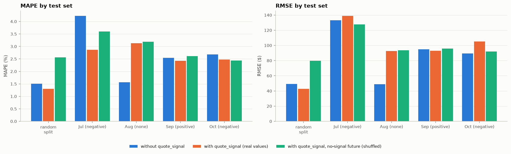

# 08 · Proof that quote_signal is a trap

Same model (gradient-boosted trees on log price), trained **with** and **without** quote_signal, scored on clean rows. Two accuracy measures throughout: **MAPE** (average % error, every load counts equally) and **RMSE** (dollar error, big misses on expensive loads count most).

quote_signal regime per month (corr with rate per mile > 0.5 = positive, < −0.5 = negative, else none): Jan positive, Feb positive, Mar positive, Apr negative, May negative, Jun positive, Jul negative, Aug none, Sep positive, Oct negative. Nov–Dec: **none** (step 06 proxy).

## 1. The careless random split says: keep it

| variant | MAPE (%) | RMSE ($) |
| --- | --- | --- |
| with quote_signal | 1.30 | 42.83 |
| with quote_signal, test values shuffled | 2.57 | 79.88 |
| without quote_signal | 1.50 | 49.28 |

With quote_signal: MAPE -14%, RMSE -13%. Looks like a clear win.

## 2. Clean test: same months, but quote_signal stripped of its meaning

Inside the random split nothing else changes (same months, same model), so shuffling quote_signal in the test fold isolates one question: how does the model do when quote_signal carries no signal, which is the Nov–Dec situation?

| variant | MAPE (%) | RMSE ($) |
| --- | --- | --- |
| without quote_signal | 1.50 | 49.28 |
| with quote_signal | 1.30 | 42.83 |
| with quote_signal, test values shuffled | 2.57 | 79.88 |

With its meaning removed, the model that relies on quote_signal is **+71% MAPE / +62% RMSE** versus the model that never used it.

## 3. Real test: August, the one training month with no signal

| train Jan–Jul → test Aug | with date feature · MAPE (%) | with date feature · RMSE ($) | no date feature · MAPE (%) | no date feature · RMSE ($) |
| --- | --- | --- | --- | --- |
| without quote_signal | 1.57 | 48.96 | 2.65 | 82.97 |
| with quote_signal | 3.13 | 92.72 | 3.51 | 97.70 |

In the real no-signal month quote_signal makes the model clearly worse, whether or not it also sees the date: MAPE 1.57% → 3.13% with a date feature, 2.65% → 3.51% without. **Nov–Dec are in the same no-signal state** (step 06: quote_signal's link to distance is 0.01 in Nov–Dec, 0.02 in August).

## 4. The other time-forward months, and why they don't change the conclusion

| test set | MAPE without qs | MAPE with qs | MAPE with qs, shuffled | RMSE without qs | RMSE with qs | RMSE with qs, shuffled |
| --- | --- | --- | --- | --- | --- | --- |
| random (avg of 5) | 1.50 | 1.30 | 2.57 | 49.28 | 42.83 | 79.88 |
| Jul (negative) | 4.22 | 2.86 | 3.60 | 133.0 | 138.8 | 127.7 |
| Aug (none) | 1.57 | 3.13 | 3.19 | 48.96 | 92.72 | 93.44 |
| Sep (positive) | 2.55 | 2.43 | 2.61 | 94.74 | 92.99 | 95.97 |
| Oct (negative) | 2.68 | 2.47 | 2.43 | 89.51 | 105.1 | 91.96 |

In July, September and October (regimes already seen in training) quote_signal still lowers MAPE, and in July and October **even the shuffled version does**. Shuffled values carry no row-level information, so that gain can't come from what quote_signal says about each load. Two confounds explain it:

- **Time extrapolation.** These baseline models have no proper time handling yet. A tree treats every future day like the last training days, so after a quarter-end ramp (end of June, end of September) the no-quote_signal model carries the peak forward: it over-predicts July by a median +3.8% and October by +1.8% (checked separately).
- **quote_signal's monthly average tracks its regime** (positive months 2.17, negative months 1.94, August 2.05; Nov–Dec 2.05). A model can use that monthly level to patch over missing time effects. That is luck, not information about the load.
- Neither confound helps in Nov–Dec: quote_signal's level there sits at the no-signal value, and time effects should be modelled properly instead (deep-dive 10).

*Blue = never used quote_signal. Orange = uses it, real values. Green = uses it, but the test data carries no signal. The two clean comparisons are the random split (left group) and August, the real no-signal month.*

## 5. Why the random split is fooled

| random 5-fold | MAPE (%) | RMSE ($) |
| --- | --- | --- |
| with qs, no date feature | 1.77 | 60.69 |
| without qs, no date feature | 2.32 | 77.87 |
| with qs, with date feature | 1.30 | 42.83 |
| without qs, with date feature | 1.50 | 49.28 |

quote_signal's meaning changes with the month. A random split puts every month in both training and test, so the model always gets to learn the current month's meaning before being tested on it. The future gives no such preview.

## 6. What it would do to the real Nov–Dec predictions

| index | mean |difference| % | median |difference| % | 95th percentile % |
| --- | --- | --- | --- |
| same model: real quote_signal vs fixed at median | 1.23 | 0.89 | 3.55 |
| with-qs model vs without-qs model | 1.81 | 1.47 | 4.73 |

Because quote_signal carries no information in Nov–Dec, every percent it moves a validation prediction is error added for nothing.

## Conclusion

- quote_signal is not a stable property of a load: its meaning flips between regimes and it is meaningless in some.
- A random split rewards it, because every test month's meaning was already learned in training.
- Whenever it carries no signal (shuffled test data, or the real month of August) the model that uses it is much worse than one that never did. For Nov–Dec the evidence (step 06) says 'no signal'.
- The apparent gains in other time-forward months come from confounds (time extrapolation, quote_signal's monthly level), not from information about the load. **Decision: drop it, and evaluate everything with time-forward splits.**
