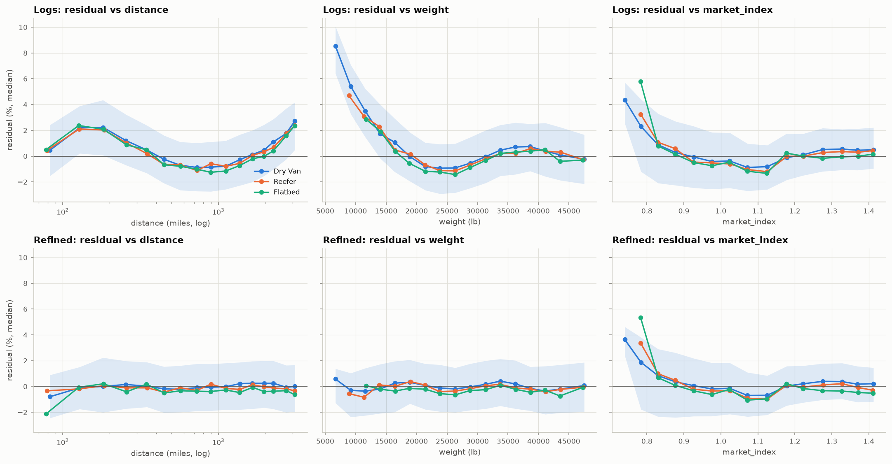
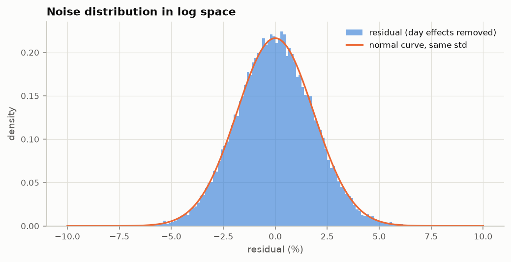

# 09 · Deep-dive: is price a simple product of independent effects?

Clean train rows (n = 47,322). Fits are ordinary least squares on log(price), in-sample and descriptive: few parameters on 47k rows, so overfitting is negligible. Time effects are left in the residual on purpose (deep-dive 10). 'Within-day noise' = residual after also removing each day's average, i.e. with time effects taken out.

## 1. Ladder: add one factor at a time (simplest shapes: logs)

| step | parameters | residual std (%) | within-day noise (%) | MAE ($) | RMSE ($) | MAPE (%) | median APE (%) |
| --- | --- | --- | --- | --- | --- | --- | --- |
| global median rate per mile × distance | 1 | 12.06 | 11.60 | 213.5 | 315.1 | 9.41 | 8.07 |
| + distance curve (power law) | 2 | 7.38 | 6.67 | 139.6 | 195.8 | 6.03 | 5.34 |
| + equipment | 4 | 5.09 | 4.03 | 92.92 | 130.4 | 4.10 | 3.52 |
| + weight | 5 | 4.53 | 3.31 | 82.01 | 114.7 | 3.64 | 3.10 |
| + market_index | 6 | 3.98 | 3.30 | 69.34 | 96.13 | 3.17 | 2.69 |
| + one effect per city (shared by pickup & delivery) | 69 | 3.15 | 2.25 | 59.06 | 86.88 | 2.51 | 2.13 |
| + separate pickup and delivery effects | 132 | 3.15 | 2.24 | 58.98 | 86.75 | 2.50 | 2.13 |
| → refined shapes (section 3), shared cities | 71 | 2.84 | 1.84 | 53.47 | 77.58 | 2.27 | 1.94 |

Each line adds one factor to the line above. A big drop means the factor matters; a flat line means it adds nothing. Separate pickup/delivery effects add nothing over one shared effect per city, so a city's price level applies whichever end of the trip it is on. The last line uses the better shapes found in section 3.

## 2. Interactions: does any factor's effect depend on another?

Base: refined shapes + shared city effects (residual std 2.844%). Each row adds one term on its own. 1 basis point = 0.01 percentage points of residual std.

| added term | coefficient | t-stat | residual std (%) | improvement (basis points) |
| --- | --- | --- | --- | --- |
| market × distance | 0.0135 | 12.7909 | 2.8391 | 0.4911 |
| market × Flatbed | -0.0077 | -3.8345 | 2.8436 | 0.0442 |
| distance at the 70-mile floor | -0.0163 | -3.5641 | 2.8437 | 0.0382 |
| weight × distance | -0.0007 | -2.5726 | 2.8438 | 0.0199 |
| weight × market | -0.0024 | -1.9746 | 2.8439 | 0.0117 |
| distance × Flatbed | -0.0008 | -1.6406 | 2.8440 | 0.0081 |
| market × Reefer | -0.0016 | -0.8734 | 2.8440 | 0.0023 |
| distance × Reefer | -0.0002 | -0.4643 | 2.8440 | 0.0006 |
| weight × Flatbed | 0.0002 | 0.4592 | 2.8440 | 0.0006 |
| weight × Reefer | -0.0002 | -0.3535 | 2.8440 | 0.0004 |
| weight was missing (imputed) | -0.0005 | -0.2754 | 2.8440 | 0.0002 |
| market_index was missing (imputed) | -0.0001 | -0.0601 | 2.8440 | 0.0000 |

With 47k rows even tiny effects can be 'statistically significant', so judge by **improvement**. Anything below a few basis points is irrelevant next to ~2% noise: **the factors act independently**.

## 3. Shapes: are logs the right curve for distance, weight and market?

*Top: with log terms, short hauls (100–250 mi) are underpriced by ~2% and the weight line bends (light loads underpriced, heavy loads overpriced). Bottom: the refined shapes flatten the lines.*

| functional form | within-day noise (%) | residual std (%) |
| --- | --- | --- |
| log d · log w · log mi  (step 04 guess) | 2.247 | 3.151 |
| log d · linear w · log mi | 2.170 | 3.096 |
| log d · linear w · linear mi | 2.169 | 3.070 |
| log d · clip(w, 20k–40k) · linear mi | 2.099 | 3.020 |
| log d + (log d)² · clip w · linear mi | 1.908 | 2.888 |
| log d + (log d)² + (log d)³ · clip w · linear mi  (refined) | 1.843 | 2.844 |
| log(d + 50) · clip w · linear mi | 2.625 | 3.404 |

Weight bounds were chosen by a grid search over lower {10k–22.5k} × upper {35k–45k}: best 20,000–40,000 lb (1.843% noise), next best 22,500–37,500 (1.847%). Round numbers 20k–40k are used.

Why clipped: the residual of a model without any weight term, by weight. It is flat below ~20k, rises steadily to ~40k, then is flat again.

| weight (lb) | residual with NO weight term (%) | loads |
| --- | --- | --- |
| (4999, 10000] | -4.63 | 200 |
| (10000, 15000] | -4.40 | 811 |
| (15000, 20000] | -3.99 | 2,704 |
| (20000, 25000] | -3.27 | 6,373 |
| (25000, 30000] | -1.57 | 10,053 |
| (30000, 35000] | 0.65 | 11,385 |
| (35000, 40000] | 2.26 | 8,787 |
| (40000, 42500] | 2.93 | 2,849 |
| (42500, 47499] | 3.10 | 2,972 |
| (47499, 47500] | 3.38 | 1,188 |

| refined structure | effect |
| --- | --- |
| distance | price ratio when distance doubles: 250→500 mi ×1.80, 500→1000 mi ×1.82, 1000→2000 mi ×1.87 |
| weight | +3.8% per +10,000 lb between 20k and 40k lb; no effect outside (full band = +7.8%) |
| market_index | +1.32% per +0.1 market_index |
| equipment | Reefer +13.0%, Flatbed +8.4% vs Dry Van |
| city | city effects span -3.7% to +3.4% (std 1.9%) |

## 4. A second outlier pass

The lane-based rule (step 03) can't catch a corrupted price on a thin lane where the corrupted value *is* the lane's median. Checking every row against the structural model (|log residual| > 0.4, i.e. off by more than ×1.5) catches **4 more**. The corruption factors are ≥ ×2.2, so the gap to genuine noise (~2%) is wide.

| load_id | pickup | delivery | distance | equipment | posted_rate | rpm | rel_rate | price vs model |
| --- | --- | --- | --- | --- | --- | --- | --- | --- |
| TR-009695 | Boston | Louisville | 1,206 | Dry Van | 5,418 | 4.491 | 1.399 | ×2.33 |
| TR-022731 | Dallas | Grand Rapids | 1,041 | Reefer | 11,895 | 11.423 | 1.689 | ×4.84 |
| TR-026575 | Tampa | Detroit | 1,253 | Reefer | 605.8 | 0.484 | 1.000 | ×0.22 |
| TR-029790 | Savannah | Detroit | 842.0 | Dry Van | 4,352 | 5.168 | 1.408 | ×2.58 |

Total removed from training: 678 rows (1.41%).

## 5. The noise: how big, what shape, constant in %?

| statistic | value |
| --- | --- |
| residual std (%) | 2.844 |
| …after removing day-level effects (%) | 1.843 |
| robust std (MAD) (%) | 1.830 |
| excess kurtosis (0 = normal) | 0.135 |
| p0.1 (%) | -5.631 |
| p99.9 (%) | 6.141 |

*Noise left after the refined structure and day-level effects.*

| distance (mi) | noise std (%) | loads |
| --- | --- | --- |
| (69, 300] | 1.926 | 3,909 |
| (300, 600] | 1.828 | 9,318 |
| (600, 1000] | 1.818 | 11,737 |
| (1000, 1500] | 1.845 | 8,882 |
| (1500, 2000] | 1.779 | 6,020 |
| (2000, 3500] | 1.899 | 7,456 |

Noise std by equipment: Dry Van 1.81%, Reefer 1.77%, Flatbed 2.05%.

### What this means for the two accuracy measures

- Noise is about the same **percentage** at every distance and for every equipment type, so % errors are comparable across loads: **MAPE** treats a $300 short haul and a $6,000 cross-country load equally.
- In dollars the same % is far bigger on long loads. The longest 20% of loads produce **57% of the squared dollar error** but only 20% of the summed % error. **RMSE** is therefore mostly a measure of long-haul accuracy.
- Reporting both shows whether a model is good on typical loads (MAPE) and on the expensive ones (RMSE). Training on log price suits MAPE; any model choice will be checked on both.
- With ~1.8% irreducible noise, a MAPE around 1.5% is roughly the floor. A test score far below that would signal leakage.
