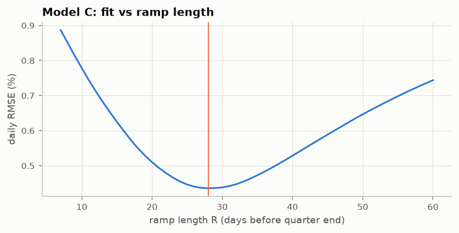
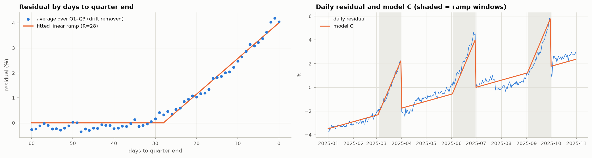
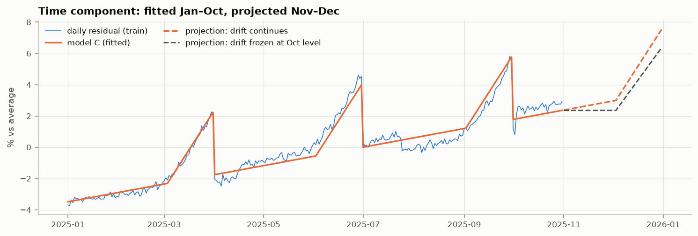
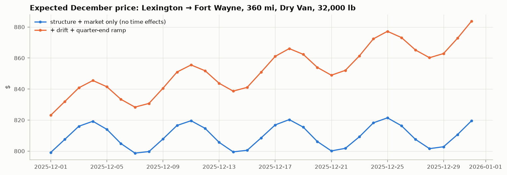

# 10 · Deep-dive: the shape of the time effects

Target: the daily average residual of the refined structural model (09), i.e. what distance, weight, market_index, equipment and city do not explain. 304 days, Jan 1 – Oct 31. Daily noise from sampling ~158 loads/day is about 0.23%, so a perfect time model would leave roughly that.

## 1. Which time model describes the residual best?

| model | parameters | daily RMSE (%) | BIC (lower = better) |
| --- | --- | --- | --- |
| A  nothing (constant) | 1 | 2.175 | -2,322 |
| B  linear drift | 2 | 1.185 | -2,685 |
| C  drift + linear ramp over last 28 days | 4 | 0.436 | -3,282 |
| C' drift + curved ramp (R=34, power=1.5) | 5 | 0.428 | -3,287 |
| D  quarter levels (steps) + ramp (R=28) | 6 | 0.471 | -3,223 |
| E  drift + ramp height per quarter (R=28) | 6 | 0.398 | -3,326 |

- Best ramp length for a straight-line ramp: **28 days** (grid 7–60).
- Model C: drift **+0.58% per 30 days**, ramp height **+4.01%** at quarter end (rising linearly from 0 at 28 days before), resetting on day 1 of the next quarter.
- Ramp height fitted separately per quarter (model E): Q1 +3.93%, Q2 +4.73%, Q3 +3.32%. Similar heights support one shared ramp.
- Lower BIC = better trade-off between fit and number of parameters. More complex variants only win if their BIC is clearly lower.

*The fit is clearly best around R ≈ 28 days, so the ramp length is well determined by the data.*

## 2. Does the pattern generalise to a quarter it hasn't seen?

| test | constant (%) | drift only (%) | drift + ramp R=28 (%) |
| --- | --- | --- | --- |
| fit Jan–Jun → predict Jul–Oct (incl. the Q3 ramp) | 2.908 | 2.512 | 1.040 |
| fit Jan–Aug → predict Sep–Oct (Q3 ramp + Oct) | 3.573 | 1.163 | 0.604 |

Daily RMSE on the held-out months. If drift + ramp, learned only from earlier quarters, predicts the later ones well, the pattern is a stable rule rather than a coincidence. (The structural model behind the residual used all months, but it has no time terms, so the time pattern itself is not fitted.)

## 3. Ramp shape up close, and what is left

*Left: the average ramp is close to a straight line rising into quarter end. Right: drift + ramp tracks the daily residual through all three quarters.*

- Leftover daily RMSE 0.44% vs ~0.23% expected from sampling alone.
- Day-to-day autocorrelation of what is left: 0.87 (≈ 0 means no slow pattern remains).
- Leftover by weekday (%): Mon +0.11, Tue -0.00, Wed -0.08, Thu -0.12, Fri -0.04, Sat +0.03, Sun +0.10.
- Leftover by month (%): Jan -0.07, Feb -0.15, Mar -0.03, Apr -0.08, May +0.37, Jun +0.53, Jul +0.05, Aug -0.62, Sep -0.42, Oct +0.41.

### The low-market bend in step 09 was a time effect

| market_index | structure only (%) | after drift + ramp (%) | loads |
| --- | --- | --- | --- |
| (0.7, 0.75] | 4.35 | -0.50 | 77 |
| (0.75, 0.8] | 2.81 | -0.04 | 797 |
| (0.8, 0.85] | 0.84 | -0.16 | 2,331 |
| (0.85, 0.9] | 0.35 | -0.10 | 3,912 |
| (0.9, 0.95] | -0.09 | -0.18 | 4,756 |
| (0.95, 1.0] | -0.31 | -0.22 | 5,567 |
| (1.0, 1.05] | -0.20 | -0.16 | 5,623 |
| (1.05, 1.1] | -0.79 | -0.28 | 4,052 |
| (1.1, 1.15] | -0.79 | -0.12 | 2,940 |
| (1.15, 1.2] | 0.07 | 0.17 | 3,647 |
| (1.2, 1.25] | 0.08 | 0.29 | 3,970 |
| (1.25, 1.3] | 0.19 | 0.29 | 2,973 |
| (1.3, 1.35] | 0.23 | 0.32 | 3,178 |
| (1.35, 1.4] | 0.03 | 0.23 | 2,818 |
| (1.4, 1.45] | -0.06 | 0.21 | 660 |

In step 09 the residual looked high at market_index < 0.8. 72% of those loads are in September, inside the Q3 ramp. Once drift + ramp are removed, the line is flat: the market effect itself is straight.

### Is the slow leftover a market effect we've mis-specified?

The leftover drifts slowly (high autocorrelation, + in May–Jun, − in Aug–Sep), which lines up with the market's seasonal level. Test: refit the structure + drift + ramp, letting price respond separately to the market's seasonal level (7-day mean), its weekly wiggle, and each load's deviation, or to a lagged (trailing) market average.

| market terms | coefficients | daily RMSE (%) | leftover autocorrelation |
| --- | --- | --- | --- |
| one market_index term | market 0.142 | 0.398 | 0.802 |
| separate: seasonal level / weekly wiggle / per-load deviation | level 0.147, weekly 0.122, per-load 0.122 | 0.364 | 0.819 |
| market_index + trailing 14-day average | market 0.130, trailing 14d 0.014 | 0.386 | 0.830 |
| market_index + trailing 28-day average | market 0.138, trailing 28d 0.005 | 0.397 | 0.817 |

Price responds about equally to the seasonal level and the weekly wiggle, and lagged market averages add nothing, so **one market_index term is the right description**. The slow leftover (about ±0.5% month to month) is not a market effect. With only 10 months it can't be pinned down; it is small next to the ~1.8% per-load noise.

## 4. What this implies for Nov–Dec and the December chart

*Projection = an assumption, not data. Both versions share the Q4 ramp in December; they differ only in whether the slow drift keeps going.*

*A sanity reference for the final model's chart, not a submission: weekly zig-zag from market_index, rising into Dec 31 from the Q4 ramp.*

| date | dow | market_index | structure only ($) | + time, drift continues ($) | + time, drift frozen ($) |
| --- | --- | --- | --- | --- | --- |
| 2025-12-01 | Mon | 0.835 | 799.2 | 823.1 | 818.2 |
| 2025-12-04 | Thu | 1.024 | 819.2 | 845.5 | 840.0 |
| 2025-12-07 | Sun | 0.831 | 798.7 | 828.4 | 822.5 |
| 2025-12-10 | Wed | 0.999 | 816.5 | 851.0 | 844.4 |
| 2025-12-13 | Sat | 0.897 | 805.7 | 843.7 | 836.8 |
| 2025-12-16 | Tue | 0.924 | 808.6 | 850.9 | 843.4 |
| 2025-12-19 | Fri | 0.989 | 815.4 | 862.4 | 854.2 |
| 2025-12-22 | Mon | 0.860 | 801.8 | 852.1 | 843.5 |
| 2025-12-25 | Thu | 1.045 | 821.4 | 877.2 | 867.9 |
| 2025-12-28 | Sun | 0.858 | 801.6 | 860.2 | 850.6 |
| 2025-12-31 | Wed | 1.027 | 819.6 | 883.8 | 873.4 |

- Structure + market alone: $799–$821, a weekly zig-zag (Thu high, Sun low).
- Adding drift + ramp: $823–$884; the last week of December sits ~4.1% above the first week's level, plus drift.
- Train history for this lane (Dry Van, all weights): median $808 (step 07). Structure-only December mean $810.
- Open modelling question: let the drift continue into Nov–Dec, or freeze it? Trees freeze it automatically (they can't extrapolate). A linear trend term continues it. Time-forward validation can tell us which works better.
