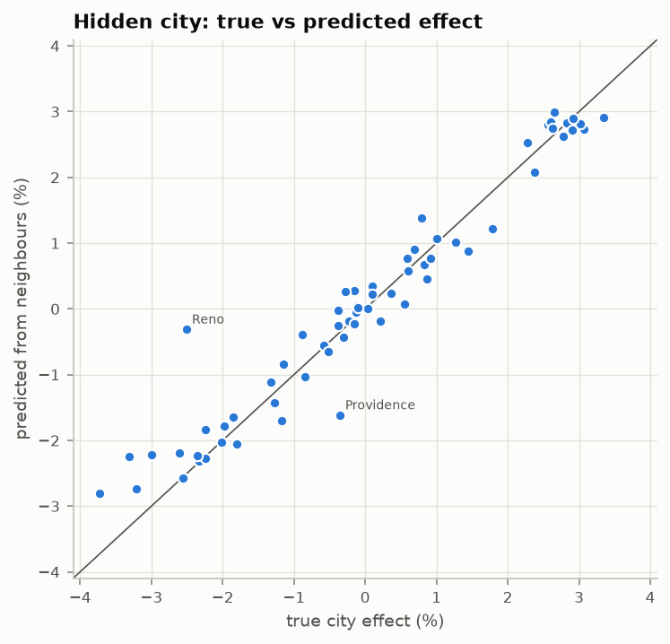
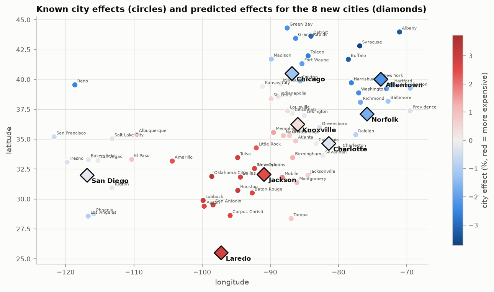

# 11 · Deep-dive: pricing cities never seen in training

City effects come from the refined structural model (09), one effect per city. They range -3.7% to +3.4% (std 1.86%). Distances between cities use the dataset's own coordinates.

## 1. Hide one city, predict its effect from the others

| method | RMSE of effect (%) | share of city variation explained |
| --- | --- | --- |
| 0  ignore (average city = 0) | 1.860 | 0.000 |
| 1  1 nearest city, plain average | 0.535 | 0.917 |
| 1  1 nearest city, distance-weighted | 0.535 | 0.917 |
| 1  2 nearest cities, plain average | 0.527 | 0.920 |
| 1  2 nearest cities, distance-weighted | 0.509 | 0.925 |
| 1  3 nearest cities, plain average | 0.502 | 0.927 |
| 1  3 nearest cities, distance-weighted | 0.476 | 0.934 |
| 1  5 nearest cities, plain average | 0.489 | 0.931 |
| 1  5 nearest cities, distance-weighted | 0.464 | 0.938 |
| 1  8 nearest cities, plain average | 0.612 | 0.892 |
| 1  8 nearest cities, distance-weighted | 0.539 | 0.916 |
| 2  linear surface over lat/lon | 1.185 | 0.594 |
| 2  quadratic surface over lat/lon | 0.866 | 0.783 |

Best: **5 nearest cities, distance-weighted**: error 0.46% vs 1.86% when ignoring the city, i.e. it recovers **94%** of a hidden city's price level from its neighbours alone.

*Each dot is one city predicted only from the others. Dots near the diagonal mean neighbours are a good stand-in.*

## 2. What that means for the price error of affected loads

| city effect used for the unseen city | MAPE of affected loads (%) | median APE (%) |
| --- | --- | --- |
| city known (its own fitted effect) | 1.505 | 1.263 |
| ignore (average city = 0) | 2.134 | 1.833 |
| 5 nearest cities, distance-weighted | 1.544 | 1.295 |

Structural model + time model (drift + ramp), in-sample. Each load is scored twice: once pretending its pickup city is new, once its delivery city. The gap between rows is the cost of not having seen a city, and how much of it the neighbours win back.

## 3. The 8 validation-only cities

| new city | nearest known cities (distance, mi) | predicted effect (%) | val loads touching it |
| --- | --- | --- | --- |
| Allentown | New York (1), Philadelphia (71), Hartford (92) | -2.23 | 171 |
| Charlotte | Savannah (86), Columbia (103), Charleston (104) | -0.29 | 176 |
| Chicago | Dayton (79), Fort Wayne (96), Milwaukee (105) | -1.23 | 179 |
| Jackson | New Orleans (81), Shreveport (88), Baton Rouge (149) | 2.48 | 193 |
| Knoxville | Cincinnati (75), Lexington (76), Chattanooga (93) | 0.33 | 170 |
| Laredo | Corpus Christi (230), San Antonio (286), Austin (309) | 2.82 | 195 |
| Norfolk | Richmond (84), Washington (137), Raleigh (150) | -1.67 | 172 |
| San Diego | Bakersfield (89), Las Vegas (127), Fresno (184) | -0.21 | 191 |

Distance to the nearest known city: new cities median 82 mi (max 230); known cities among themselves median 91 mi. New cities are about as close to their neighbours as known cities are, so the hide-one-city test above is a fair simulation of their situation.

*New cities get the price level of their neighbourhood.*

- A model should describe location by coordinates (or neighbour-based city effects), not city names: names give no information about a new city.
- Tree models with lat/lon features learn this neighbourhood structure naturally. A linear model needs it supplied as a feature (e.g. the k-nearest-neighbour city effect).
