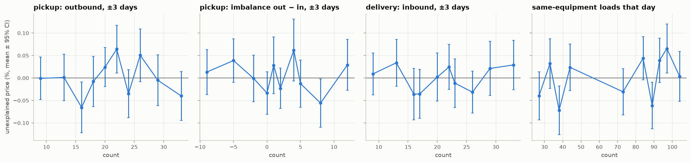
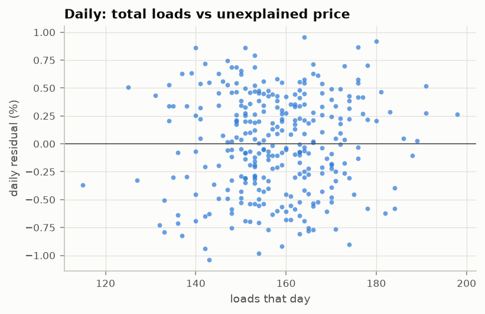

# 12 · Deep-dive: does load volume affect price?

Volume counts are computed from all loads in the file. The price signal tested is the residual after the refined structural model (09) and the drift + quarter-end ramp (10): whatever distance, weight, market, equipment, city and time do not explain.

## 1. The volume counts

| count per load | train median | train p10–p90 | validation median |
| --- | --- | --- | --- |
| loads that day | 158.0 | 143.0–174.0 | 198.0 |
| same-equipment loads that day | 80.00 | 30.0–99.0 | 98.00 |
| equipment share of the day | 0.52 | 0.19–0.6 | 0.53 |
| pickup city: outbound loads that day | 4.00 | 2.0–6.0 | 4.00 |
| delivery city: inbound loads that day | 4.00 | 2.0–6.0 | 4.00 |
| pickup city: outbound, ±3 days | 21.00 | 11.0–30.0 | 22.00 |
| pickup city: imbalance out − in, ±3 days | 1.00 | -7.0–9.0 | 1.00 |
| delivery city: inbound, ±3 days | 20.00 | 11.0–30.0 | 23.00 |
| delivery city: imbalance in − out, ±3 days | 1.00 | -7.0–9.0 | 1.00 |
| pickup city: outbound that month | 88.00 | 47.0–121.0 | 100.0 |
| lane: loads that month | 2.00 | 1.0–4.0 | 2.00 |

Validation has more loads per day (sampling), so raw counts are higher there. If any count mattered we would need a normalised version (e.g. a share of the day's loads). First: does any of them matter at all?

## 2. Is there any relationship with the unexplained price?

| volume measure | compared with | n | Spearman ρ | p-value | price change per +1 std of volume (%) |
| --- | --- | --- | --- | --- | --- |
| loads that day | daily residual | 304 | 0.0334 | 0.5623 | 0.0288 |
| same-equipment loads that day | within-day residual | 47,322 | 0.0135 | 0.0032 | 0.0119 |
| equipment share of the day | within-day residual | 47,322 | 0.0160 | 0.0005 | 0.0145 |
| pickup city: outbound loads that day | within-day residual | 47,322 | -0.0031 | 0.4975 | -0.0048 |
| delivery city: inbound loads that day | within-day residual | 47,322 | 0.0079 | 0.0859 | 0.0151 |
| pickup city: outbound, ±3 days | within-day residual | 47,322 | -0.0003 | 0.9464 | -0.0019 |
| pickup city: imbalance out − in, ±3 days | within-day residual | 47,322 | -0.0065 | 0.1579 | -0.0097 |
| delivery city: inbound, ±3 days | within-day residual | 47,322 | 0.0005 | 0.9130 | 0.0034 |
| delivery city: imbalance in − out, ±3 days | within-day residual | 47,322 | 0.0106 | 0.0213 | 0.0146 |
| pickup city: outbound that month | within-day residual | 47,322 | -0.0004 | 0.9333 | -0.0034 |
| lane: loads that month | within-day residual | 47,322 | -0.0055 | 0.2277 | -0.0015 |

Baseline for 'no effect': correlating the residual with randomly shuffled values gives |ρ| up to 0.0086 (95th percentile of 200 shuffles, n = 47,322). Correlations of that size are noise.

Joint test: all load-level volume measures together explain 0.032% of the within-day residual variance (residual std improves by 0.03 basis points).

*Unexplained price by volume decile. Flat lines inside ±0.1% mean busier cities/days are not priced differently.*

*Each dot is one day (Jan–Oct).*

## 3. Is market_index just volume in disguise?

Daily load count vs daily market_index: Spearman ρ = 0.090. Loads per weekday: Mon 157, Tue 157, Wed 159, Thu 158, Fri 159, Sat 157, Sun 158. Volume is flat across the week while market_index swings Thu-high / Sun-low, so the market index is not a volume count.

## Conclusion

- The largest effect of any volume measure is +0.029% per standard deviation (loads that day). Next to ~1.8% per-load noise that is negligible.
- No sign that busy days, busy cities, trailer-type demand, directional imbalance or lane popularity move prices.
- **Decision: no volume features.** This also means validation's higher daily load count is a sampling difference, not a market signal.
