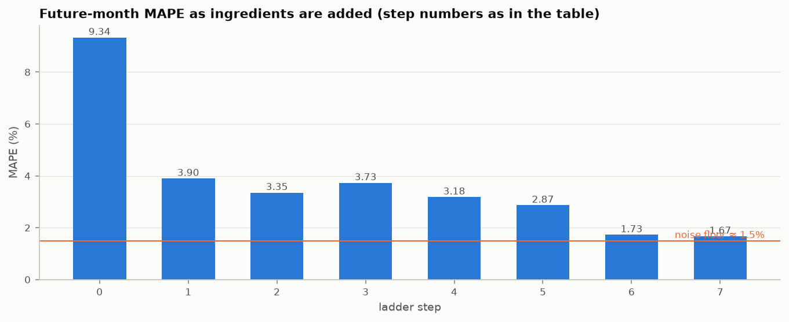
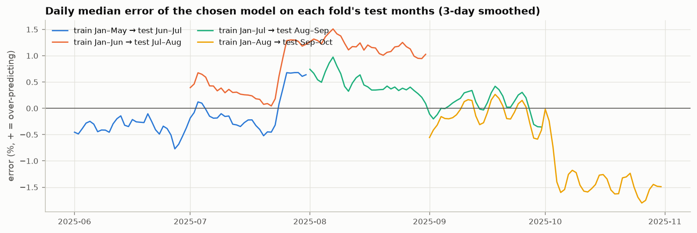

# Modelling 01 · Baselines and the structural model

Every number on this page is measured on **future months the model never saw**, averaged over 4 folds, on test rows with genuine labels. Lower is better for every column except bias (best near 0).

## 1. How models are judged

The real task is: learn from Jan–Oct, predict the next **two** months, where 12% of loads involve a city never seen. Each fold copies that: train up to a cut-off, test on the next two months, and hide 4 random cities from training. Cleaning and corrupted-label removal are redone inside each fold using the training part only (no peeking).

| fold | train rows (clean) | test rows | hidden cities | test rows with an unseen city | test rows with genuine labels |
| --- | --- | --- | --- | --- | --- |
| train Jan–May → test Jun–Jul | 20,076 | 9,695 | Dayton, Lexington, Milwaukee, Richmond | 15.6% | 98.7% |
| train Jan–Jun → test Jul–Aug | 25,320 | 9,671 | Indianapolis, Las Vegas, Phoenix, Toledo | 11.0% | 98.6% |
| train Jan–Jul → test Aug–Sep | 29,689 | 9,429 | Baltimore, Dallas, El Paso, Richmond | 11.0% | 98.6% |
| train Jan–Aug → test Sep–Oct | 32,904 | 9,523 | Bakersfield, Charleston, Corpus Christi, Raleigh | 13.3% | 98.5% |

- **MAPE** = average % error (every load counts equally). **RMSE** = typical $ error, dominated by long, expensive loads.
- Also shown: MAE ($), median % error, MAPE split by seen/unseen cities and by first/second test month, median bias (+ = over-predicting), and the worst fold's MAPE (stability).
- Corrupted test labels (~1.4%) are excluded from scoring because nobody can predict a randomly ×4 price; 'RMSE all rows' in the detailed tables shows the effect of keeping them.

## 2. Ladder: one ingredient at a time

| model | MAPE (%) | RMSE ($) | MAE ($) | median APE (%) | MAPE seen cities (%) | MAPE unseen cities (%) | MAPE month 1 (%) | MAPE month 2 (%) | bias (%) | worst-fold MAPE (%) |
| --- | --- | --- | --- | --- | --- | --- | --- | --- | --- | --- |
| 0 naive: typical price per mile × distance | 9.34 | 291.6 | 203.5 | 7.92 | 9.33 | 9.35 | 9.47 | 9.21 | -1.37 | 9.65 |
| 1 + distance curve + equipment | 3.90 | 125.3 | 90.57 | 3.46 | 3.93 | 3.73 | 4.18 | 3.62 | -1.47 | 5.12 |
| 2 + weight (20k–40k band) | 3.35 | 105.4 | 77.16 | 3.00 | 3.41 | 3.04 | 3.70 | 3.01 | -1.44 | 4.86 |
| 3 + market_index | 3.73 | 116.1 | 85.82 | 3.37 | 3.77 | 3.45 | 3.58 | 3.90 | -2.91 | 4.62 |
| 4 + city effects (unseen city = average) | 3.18 | 103.4 | 75.21 | 2.90 | 3.20 | 3.06 | 2.96 | 3.42 | -2.77 | 4.36 |
| 5 + quarter-end ramp | 2.87 | 90.64 | 67.35 | 2.72 | 2.89 | 2.70 | 2.48 | 3.26 | -2.62 | 3.75 |
| 6 + slow drift (continues into test) | 1.73 | 59.02 | 40.65 | 1.46 | 1.67 | 2.17 | 1.64 | 1.81 | 0.46 | 1.93 |
| 7 + unseen cities from 5 nearest neighbours | 1.67 | 57.16 | 39.40 | 1.42 | 1.67 | 1.71 | 1.60 | 1.75 | 0.40 | 1.86 |

What each step bought (MAPE change): + distance curve + equipment: -5.44; + weight (20k–40k band): -0.54; + market_index: +0.38; + city effects (unseen city = average): -0.55; + quarter-end ramp: -0.32; + slow drift (continues into test): -1.14; + unseen cities from 5 nearest neighbours: -0.06.

*Distance + equipment do most of the work; weight, city effects and the two time terms close most of the remaining gap. market_index only pays off once the drift is in the model (step 3 vs 6).*

### Why adding market_index alone made things worse (step 3)

| fold | market coefficient, no time terms | market coefficient, with ramp + drift |
| --- | --- | --- |
| train Jan–May → test Jun–Jul | 0.182 | 0.126 |
| train Jan–Jun → test Jul–Aug | 0.205 | 0.121 |
| train Jan–Jul → test Aug–Sep | 0.203 | 0.138 |
| train Jan–Aug → test Sep–Oct | 0.185 | 0.146 |

Without time terms, the market coefficient is inflated (it soaks up the upward drift that happens to coincide with the market's spring rise), so it mispredicts the future (bias −2.9%). With the drift in the model the coefficient settles at ≈ 0.13, the value found in the EDA, and market_index becomes useful. Ingredients interact through confounding, which is why the order of the ladder matters and why the final model has to include all of them together.

## 3. Hyperparameters: sweep each around its EDA value

The structural model has only a handful of settings, each suggested by the EDA. Each is swept on its own with the others at their default (marked ◀), scored on the same future-month folds. Rule: move away from the EDA value only if MAPE improves by ≥ 0.02 points **and** RMSE also improves. Smaller differences are within fold-to-fold noise, and chasing them would tune to these 4 folds rather than to the future.

### drift handling

| value | MAPE (%) | RMSE ($) | worst-fold MAPE (%) | MAPE month 2 (%) | MAPE unseen cities (%) | bias (%) |
| --- | --- | --- | --- | --- | --- | --- |
| none | 2.893 | 91.318 | 3.737 | 3.293 | 2.936 | -2.685 |
| freeze | 1.622 | 55.947 | 1.869 | 1.683 | 1.647 | -0.283 |
| damped | 1.617 | 55.613 | 1.740 | 1.663 | 1.646 | 0.061 |
| continue ◀ | 1.670 | 57.158 | 1.862 | 1.746 | 1.707 | 0.396 |

Per fold (MAPE %): 'freeze' and 'continue' each win two folds, so the data cannot tell them apart. The month-to-month wiggle the EDA found (±0.5%) decides each fold. 'Damped' (half speed, i.e. the average of the two) is a hedge that is never the worst.

| fold | MAPE freeze (%) | MAPE damped (%) | MAPE continue (%) |
| --- | --- | --- | --- |
| train Jan–Aug → test Sep–Oct | 1.869 | 1.740 | 1.642 |
| train Jan–Jul → test Aug–Sep | 1.538 | 1.542 | 1.593 |
| train Jan–Jun → test Jul–Aug | 1.495 | 1.638 | 1.862 |
| train Jan–May → test Jun–Jul | 1.587 | 1.548 | 1.583 |

→ switch to **damped** (MAPE −0.053 pts, RMSE −$1.55).

### quarter-end ramp length (days)

| value | MAPE (%) | RMSE ($) | worst-fold MAPE (%) | MAPE month 2 (%) | MAPE unseen cities (%) | bias (%) |
| --- | --- | --- | --- | --- | --- | --- |
| 0 | 2.571 | 84.966 | 4.379 | 2.764 | 2.629 | 1.045 |
| 14 | 1.908 | 64.322 | 2.573 | 2.016 | 1.964 | 0.471 |
| 21 | 1.747 | 59.361 | 2.116 | 1.835 | 1.792 | 0.385 |
| 28 ◀ | 1.670 | 57.158 | 1.862 | 1.746 | 1.707 | 0.396 |
| 35 | 1.660 | 57.013 | 1.757 | 1.731 | 1.691 | 0.416 |
| 42 | 1.693 | 58.350 | 1.769 | 1.770 | 1.716 | 0.399 |

→ keep the EDA value **28** (best alternative gains 0.010 MAPE pts, $0.14 RMSE).

### weight shape

| value | MAPE (%) | RMSE ($) | worst-fold MAPE (%) | MAPE month 2 (%) | MAPE unseen cities (%) | bias (%) |
| --- | --- | --- | --- | --- | --- | --- |
| log weight (no band) | 1.779 | 61.028 | 1.967 | 1.852 | 1.820 | 0.404 |
| linear (no band) | 1.724 | 58.930 | 1.898 | 1.796 | 1.755 | 0.373 |
| (15000, 40000) | 1.687 | 57.685 | 1.876 | 1.761 | 1.719 | 0.391 |
| (20000, 40000) ◀ | 1.670 | 57.158 | 1.862 | 1.746 | 1.707 | 0.396 |
| (20000, 45000) | 1.699 | 58.112 | 1.879 | 1.774 | 1.733 | 0.382 |
| (25000, 40000) | 1.707 | 58.207 | 1.891 | 1.784 | 1.746 | 0.393 |

→ keep the EDA value **(20000, 40000)** (best alternative gains 0.000 MAPE pts, $0.00 RMSE).

### distance curve (polynomial degree in log distance)

| value | MAPE (%) | RMSE ($) | worst-fold MAPE (%) | MAPE month 2 (%) | MAPE unseen cities (%) | bias (%) |
| --- | --- | --- | --- | --- | --- | --- |
| 1 | 1.857 | 62.505 | 2.044 | 1.928 | 1.893 | 0.413 |
| 2 | 1.708 | 57.446 | 1.888 | 1.783 | 1.734 | 0.385 |
| 3 ◀ | 1.670 | 57.158 | 1.862 | 1.746 | 1.707 | 0.396 |
| 4 | 1.667 | 56.942 | 1.859 | 1.743 | 1.706 | 0.394 |

→ keep the EDA value **3** (best alternative gains 0.003 MAPE pts, $0.22 RMSE).

### neighbours used for unseen cities

| value | MAPE (%) | RMSE ($) | worst-fold MAPE (%) | MAPE month 2 (%) | MAPE unseen cities (%) | bias (%) |
| --- | --- | --- | --- | --- | --- | --- |
| 1 | 1.669 | 57.043 | 1.858 | 1.742 | 1.696 | 0.380 |
| 3 | 1.667 | 57.059 | 1.855 | 1.741 | 1.681 | 0.383 |
| 5 ◀ | 1.670 | 57.158 | 1.862 | 1.746 | 1.707 | 0.396 |
| 8 | 1.670 | 57.188 | 1.865 | 1.745 | 1.707 | 0.389 |

→ keep the EDA value **5** (best alternative gains 0.003 MAPE pts, $0.10 RMSE).

## 4. The chosen structural model

Settings: distance_degree = 3, weight_bounds = (20000, 40000), ramp_days = 28, trend = damped, unseen = knn, knn_k = 5

| fold | MAPE (%) | RMSE ($) | MAE ($) | MAPE seen cities (%) | MAPE unseen cities (%) | MAPE month 1 (%) | MAPE month 2 (%) | bias (%) | RMSE all rows ($) |
| --- | --- | --- | --- | --- | --- | --- | --- | --- | --- |
| train Jan–May → test Jun–Jul | 1.55 | 55.84 | 37.87 | 1.55 | 1.56 | 1.63 | 1.47 | -0.15 | 662.1 |
| train Jan–Jun → test Jul–Aug | 1.64 | 55.96 | 38.50 | 1.62 | 1.77 | 1.56 | 1.72 | 0.88 | 619.0 |
| train Jan–Jul → test Aug–Sep | 1.54 | 52.91 | 36.06 | 1.54 | 1.54 | 1.46 | 1.63 | 0.31 | 612.2 |
| train Jan–Aug → test Sep–Oct | 1.74 | 57.74 | 40.31 | 1.74 | 1.72 | 1.64 | 1.84 | -0.79 | 630.5 |

Where the errors are (all folds pooled):

| index | MAPE (%) | test rows |
| --- | --- | --- |
| distance: (69, 300] | 1.66 | 3,147 |
| distance: (300, 600] | 1.63 | 7,498 |
| distance: (600, 1000] | 1.61 | 9,327 |
| distance: (1000, 1500] | 1.62 | 7,086 |
| distance: (1500, 2000] | 1.55 | 4,746 |
| distance: (2000, 3500] | 1.64 | 5,977 |
| equipment: Dry Van | 1.55 | 21,380 |
| equipment: Flatbed | 1.87 | 6,860 |
| equipment: Reefer | 1.58 | 9,541 |

*Systematic drifts away from 0 would show the time terms mis-extrapolating. Overlapping folds share months, so lines should roughly agree.*
