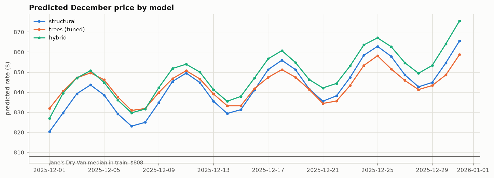
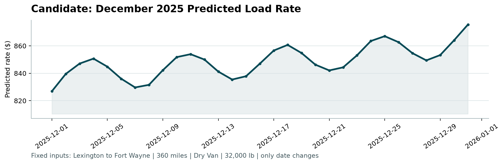

# Modelling 03 · Finalists, December behaviour and a preview run of the scorer

## 1. Scoreboard (future months, 4 folds, hidden cities)

| model | MAPE (%) | RMSE ($) | MAE ($) | MAPE seen cities (%) | MAPE unseen cities (%) | MAPE month 2 (%) | bias (%) | worst-fold MAPE (%) |
| --- | --- | --- | --- | --- | --- | --- | --- | --- |
| 0 naive: typical price per mile × distance | 9.336 | 291.6 | 203.5 | 9.327 | 9.349 | 9.211 | -1.372 | 9.647 |
| structural v1 (Modelling 01) | 1.617 | 55.613 | 38.186 | 1.613 | 1.646 | 1.663 | 0.061 | 1.740 |
| trees alone, tuned | 1.820 | 62.015 | 43.028 | 1.797 | 1.969 | 1.947 | -0.532 | 2.124 |
| hybrid on v1 | 1.488 | 50.831 | 35.115 | 1.477 | 1.565 | 1.568 | -0.029 | 1.582 |
| structural v2 (+ ramp per equipment) | 1.532 | 52.308 | 36.132 | 1.528 | 1.564 | 1.602 | 0.052 | 1.626 |
| hybrid on v2 | 1.483 | 50.498 | 34.966 | 1.471 | 1.566 | 1.562 | -0.028 | 1.570 |

Selection rule: the simpler model wins unless the more complex one is better by ≥ 0.02 MAPE points and ≥ $1 RMSE. Hybrid on v2: 1.483% / $50.5; structural v2: 1.532% / $52.3. The gain is clear, so **the hybrid on v2 is the front-runner**.

Final fits use all 47,322 clean training rows (678 corrupted labels removed), all 64 cities.

## 2. December chart behaviour (Lexington → Fort Wayne, 360 mi, Dry Van, 32,000 lb)

The December file has no market_index or coordinates. Coordinates come from the city lookup; market_index is each December day's average over the validation file (≈199 loads per day).



*What each finalist draws. Expected from the EDA: weekly zig-zag (Thu high, Sun low) rising into Dec 31 (quarter-end ramp).*

| date | dow | market_index | structural | trees (tuned) | hybrid |
| --- | --- | --- | --- | --- | --- |
| 2025-12-01 | Mon | 0.835 | 820.3 | 831.9 | 826.9 |
| 2025-12-02 | Tue | 0.915 | 829.7 | 840.5 | 839.5 |
| 2025-12-03 | Wed | 0.994 | 839.2 | 847.1 | 847.1 |
| 2025-12-04 | Thu | 1.024 | 843.6 | 849.6 | 850.7 |
| 2025-12-05 | Fri | 0.975 | 838.5 | 846.2 | 844.8 |
| 2025-12-06 | Sat | 0.889 | 829.1 | 837.6 | 836.0 |
| 2025-12-07 | Sun | 0.831 | 823.0 | 830.9 | 829.7 |
| 2025-12-08 | Mon | 0.840 | 824.9 | 831.8 | 831.6 |
| 2025-12-09 | Tue | 0.917 | 834.8 | 839.8 | 842.3 |
| 2025-12-10 | Wed | 0.999 | 845.3 | 846.7 | 851.8 |
| 2025-12-11 | Thu | 1.027 | 849.5 | 850.7 | 853.9 |
| 2025-12-12 | Fri | 0.981 | 844.8 | 846.6 | 850.0 |
| 2025-12-13 | Sat | 0.897 | 835.5 | 839.1 | 841.2 |
| 2025-12-14 | Sun | 0.838 | 829.4 | 833.2 | 835.4 |
| 2025-12-15 | Mon | 0.848 | 831.3 | 833.2 | 837.9 |
| 2025-12-16 | Tue | 0.924 | 841.1 | 841.8 | 847.1 |
| 2025-12-17 | Wed | 1.002 | 851.2 | 847.4 | 856.6 |
| 2025-12-18 | Thu | 1.034 | 855.9 | 851.2 | 860.7 |
| 2025-12-19 | Fri | 0.989 | 851.2 | 847.4 | 854.8 |
| 2025-12-20 | Sat | 0.902 | 841.6 | 841.3 | 846.3 |
| 2025-12-21 | Sun | 0.844 | 835.5 | 834.4 | 842.1 |
| 2025-12-22 | Mon | 0.860 | 838.2 | 835.6 | 844.3 |
| 2025-12-23 | Tue | 0.930 | 847.4 | 843.4 | 853.1 |
| 2025-12-24 | Wed | 1.015 | 858.4 | 853.3 | 863.5 |
| 2025-12-25 | Thu | 1.045 | 862.8 | 858.1 | 867.1 |
| 2025-12-26 | Fri | 0.997 | 857.8 | 851.6 | 862.7 |
| 2025-12-27 | Sat | 0.915 | 848.6 | 845.8 | 854.7 |
| 2025-12-28 | Sun | 0.858 | 842.6 | 841.3 | 849.4 |
| 2025-12-29 | Mon | 0.870 | 844.8 | 843.3 | 853.3 |
| 2025-12-30 | Tue | 0.944 | 854.6 | 848.6 | 864.1 |
| 2025-12-31 | Wed | 1.027 | 865.5 | 858.7 | 875.5 |

- structural: first week avg $832, last week avg $854 (+2.6%), weekly swing ≈ $21
- trees (tuned): first week avg $841, last week avg $850 (+1.1%), weekly swing ≈ $17
- hybrid: first week avg $839, last week avg $861 (+2.6%), weekly swing ≈ $20

## 3. Sanity checks on the 12,000 Nov–Dec predictions

| index | min $ | median $ | max $ | any ≤ 0 | median $/mile Nov | median $/mile Dec |
| --- | --- | --- | --- | --- | --- | --- |
| structural | 195.5 | 2,071 | 7,115 | False | 2.147 | 2.202 |
| trees (tuned) | 191.2 | 2,061 | 7,018 | False | 2.156 | 2.180 |
| hybrid | 195.1 | 2,065 | 7,062 | False | 2.143 | 2.197 |

Train median $/mile by month for comparison: Jan 2.029, Feb 2.061, Mar 2.140, Apr 2.147, May 2.191, Jun 2.247, Jul 2.187, Aug 2.121, Sep 2.159, Oct 2.164.

- Structural vs hybrid: median difference 0.32%, 99th percentile 1.32%.
- Structural vs trees: median difference 0.78%, 99th percentile 2.95%; on loads touching a new city 0.83% vs 0.78% elsewhere.

## 4. Preview: official scorer on the front-runner (hybrid)

Scorer output:

```
Validated 12,000 final predictions.
Validated 31 fixed December predictions.
Created chart: /home/neill-rawani/Documents/Assignments/Company Assignments/SpotterAI/A1/outputs/preview/scorer_results/candidate_december.png
Final validation metrics are calculated by Spotter after submission.
```



*The chart exactly as score.py draws it (preview, not final).*
