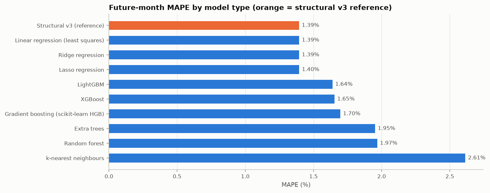

# Modelling 05 · Standard model types, each tuned, on the same features

Same 4 future-month folds with hidden cities as every other step. Every model gets the same leak-free features (EDA terms, coordinates, days to quarter end, and city / lane price levels learned without seeing each row's own price). Linear models use the formula-style subset; flexible models use all 20. Target: log price per mile.

## 1. Features given to the models

- **Linear models (14)**: log_distance, z2, z3, weight_clip, mi, reefer, flatbed, ramp, ramp_reefer, ramp_flatbed, t, city_pickup, city_delivery, lane
- **Flexible models (20)**: log_distance, z2, z3, weight_abs, weight_clip, mi, reefer, flatbed, days_to_qe, ramp, ramp_reefer, ramp_flatbed, t, pickup_lat, pickup_lon, delivery_lat, delivery_lon, city_pickup, city_delivery, lane
- City and lane levels for training rows come from 5-fold estimates inside the training data, so no row sees its own price. Unseen cities get the 5-nearest-neighbour level; unseen lanes get 0.

## 2. Leaderboard (best setting of each model type)

| model | MAPE (%) | RMSE ($) | MAE ($) | MAPE seen cities (%) | MAPE unseen cities (%) | MAPE month 2 (%) | bias (%) | worst-fold MAPE (%) |
| --- | --- | --- | --- | --- | --- | --- | --- | --- |
| Structural v3 (reference) | 1.394 | 47.676 | 32.948 | 1.370 | 1.564 | 1.470 | 0.046 | 1.494 |
| Linear regression (least squares) | 1.395 | 47.693 | 32.958 | 1.370 | 1.567 | 1.472 | 0.047 | 1.500 |
| Ridge regression | 1.395 | 47.694 | 32.958 | 1.370 | 1.567 | 1.472 | 0.047 | 1.500 |
| Lasso regression | 1.395 | 47.700 | 32.965 | 1.371 | 1.567 | 1.472 | 0.046 | 1.500 |
| LightGBM | 1.639 | 55.353 | 38.546 | 1.618 | 1.799 | 1.736 | -0.611 | 1.860 |
| XGBoost | 1.654 | 55.707 | 38.854 | 1.631 | 1.822 | 1.755 | -0.660 | 1.940 |
| Gradient boosting (scikit-learn HGB) | 1.697 | 58.472 | 40.390 | 1.678 | 1.843 | 1.824 | -0.573 | 1.912 |
| Extra trees | 1.952 | 67.763 | 46.594 | 1.939 | 2.047 | 1.981 | -0.420 | 2.267 |
| Random forest | 1.968 | 67.646 | 46.676 | 1.950 | 2.097 | 1.972 | -0.686 | 2.353 |
| k-nearest neighbours | 2.614 | 87.724 | 61.440 | 2.608 | 2.643 | 2.609 | 0.015 | 2.817 |

*Every model type at its best tuned setting, same features, same folds.*

MAPE per fold:

| model | train Jan–Aug → test Sep–Oct | train Jan–Jul → test Aug–Sep | train Jan–Jun → test Jul–Aug | train Jan–May → test Jun–Jul |
| --- | --- | --- | --- | --- |
| Structural v3 (reference) | 1.489 | 1.281 | 1.494 | 1.313 |
| Linear regression (least squares) | 1.489 | 1.278 | 1.500 | 1.312 |
| Ridge regression | 1.489 | 1.278 | 1.500 | 1.312 |
| Lasso regression | 1.490 | 1.278 | 1.500 | 1.312 |
| LightGBM | 1.860 | 1.382 | 1.484 | 1.833 |
| XGBoost | 1.940 | 1.387 | 1.448 | 1.843 |
| Gradient boosting (scikit-learn HGB) | 1.816 | 1.425 | 1.635 | 1.912 |
| Extra trees | 2.048 | 1.689 | 1.804 | 2.267 |
| Random forest | 2.157 | 1.650 | 1.712 | 2.353 |
| k-nearest neighbours | 2.460 | 2.651 | 2.528 | 2.817 |

Model types that beat structural v3 by the clear-gain bar (≥ 0.02 MAPE pts and ≥ $1 RMSE): **none**.

## 3. Tuning details per model type

Each search ran on the same 4 folds; the table shows every setting tried, best first. Picking the best of several settings on the same folds flatters the flexible models slightly; the same procedure was applied to all.

### Linear regression (least squares)

| MAPE (%) | RMSE ($) | worst-fold MAPE (%) |
| --- | --- | --- |
| 1.395 | 47.693 | 1.500 |

### Ridge regression

| alpha | MAPE (%) | RMSE ($) | worst-fold MAPE (%) |
| --- | --- | --- | --- |
| 0.010 | 1.395 | 47.694 | 1.500 |
| 0.100 | 1.395 | 47.694 | 1.500 |
| 1.000 | 1.395 | 47.694 | 1.500 |
| 10.000 | 1.395 | 47.703 | 1.501 |
| 100.0 | 1.399 | 47.814 | 1.511 |

### Lasso regression

| alpha | MAPE (%) | RMSE ($) | worst-fold MAPE (%) |
| --- | --- | --- | --- |
| 0.000 | 1.395 | 47.700 | 1.500 |
| 0.000 | 1.400 | 47.792 | 1.508 |
| 0.001 | 1.510 | 51.020 | 1.629 |
| 0.010 | 3.108 | 99.051 | 3.363 |

### k-nearest neighbours

| k | MAPE (%) | RMSE ($) | worst-fold MAPE (%) |
| --- | --- | --- | --- |
| 15 | 2.614 | 87.724 | 2.817 |
| 30 | 2.670 | 88.850 | 2.900 |
| 5 | 2.674 | 90.347 | 2.813 |
| 60 | 2.800 | 92.235 | 3.059 |

### Random forest

| max_features | min_samples_leaf | MAPE (%) | RMSE ($) | worst-fold MAPE (%) |
| --- | --- | --- | --- | --- |
| 0.300 | 1 | 1.968 | 67.646 | 2.353 |
| 0.500 | 5 | 2.077 | 71.975 | 2.428 |
| 0.800 | 1 | 2.181 | 76.444 | 2.376 |
| 0.300 | 20 | 2.256 | 76.350 | 2.779 |
| 0.500 | 20 | 2.266 | 77.969 | 2.698 |
| 0.800 | 20 | 2.460 | 85.818 | 2.702 |

### Extra trees

| max_features | min_samples_leaf | MAPE (%) | RMSE ($) | worst-fold MAPE (%) |
| --- | --- | --- | --- | --- |
| 0.500 | 1 | 1.952 | 67.763 | 2.267 |
| 1.000 | 1 | 1.982 | 69.110 | 2.249 |
| 0.800 | 5 | 2.050 | 71.016 | 2.393 |
| 1.000 | 5 | 2.054 | 71.314 | 2.378 |

### Gradient boosting (scikit-learn HGB)

| learning_rate | max_iter | max_leaf_nodes | min_samples_leaf | l2_regularization | MAPE (%) | RMSE ($) | worst-fold MAPE (%) |
| --- | --- | --- | --- | --- | --- | --- | --- |
| 0.100 | 500 | 15 | 50 | 0.000 | 1.697 | 58.472 | 1.912 |
| 0.100 | 500 | 15 | 20 | 0.000 | 1.712 | 59.057 | 1.986 |
| 0.060 | 1,000 | 15 | 20 | 10.000 | 1.728 | 58.985 | 1.964 |
| 0.060 | 500 | 31 | 50 | 1.000 | 1.730 | 58.954 | 2.020 |
| 0.100 | 1,500 | 31 | 100 | 10.000 | 1.769 | 60.112 | 2.035 |
| 0.060 | 1,000 | 63 | 50 | 1.000 | 1.780 | 61.112 | 2.043 |
| 0.030 | 500 | 15 | 20 | 0.000 | 1.798 | 61.453 | 2.002 |
| 0.060 | 1,500 | 63 | 50 | 0.000 | 1.820 | 62.283 | 2.046 |

### LightGBM

| learning_rate | n_estimators | num_leaves | min_child_samples | reg_lambda | colsample_bytree | subsample | MAPE (%) | RMSE ($) | worst-fold MAPE (%) |
| --- | --- | --- | --- | --- | --- | --- | --- | --- | --- |
| 0.050 | 1,000 | 31 | 30 | 1.000 | 0.600 | 1.000 | 1.639 | 55.353 | 1.860 |
| 0.050 | 500 | 63 | 30 | 10.000 | 0.600 | 1.000 | 1.663 | 56.114 | 1.896 |
| 0.020 | 2,000 | 15 | 10 | 0.000 | 0.800 | 0.700 | 1.674 | 57.062 | 1.900 |
| 0.100 | 500 | 15 | 100 | 0.000 | 0.600 | 1.000 | 1.685 | 58.268 | 1.874 |
| 0.100 | 500 | 15 | 10 | 10.000 | 0.600 | 1.000 | 1.686 | 57.212 | 1.871 |
| 0.050 | 1,000 | 15 | 10 | 1.000 | 0.800 | 1.000 | 1.692 | 57.705 | 1.932 |
| 0.020 | 1,000 | 15 | 30 | 1.000 | 1.000 | 0.700 | 1.732 | 58.967 | 1.960 |
| 0.100 | 2,000 | 63 | 30 | 0.000 | 0.600 | 0.700 | 1.742 | 58.861 | 2.000 |
| 0.100 | 1,000 | 31 | 30 | 0.000 | 0.800 | 0.700 | 1.758 | 59.465 | 1.957 |
| 0.100 | 1,000 | 63 | 10 | 1.000 | 0.800 | 0.700 | 1.778 | 60.315 | 1.936 |
| 0.020 | 1,000 | 63 | 30 | 10.000 | 1.000 | 1.000 | 1.797 | 61.583 | 2.054 |
| 0.020 | 500 | 15 | 100 | 0.000 | 1.000 | 0.700 | 1.856 | 63.224 | 2.104 |

### XGBoost

| learning_rate | n_estimators | max_depth | min_child_weight | reg_lambda | subsample | colsample_bytree | MAPE (%) | RMSE ($) | worst-fold MAPE (%) |
| --- | --- | --- | --- | --- | --- | --- | --- | --- | --- |
| 0.020 | 1,000 | 8 | 20 | 10.000 | 1.000 | 0.600 | 1.654 | 55.707 | 1.940 |
| 0.050 | 2,000 | 4 | 20 | 1.000 | 0.700 | 1.000 | 1.672 | 56.902 | 1.873 |
| 0.100 | 1,000 | 4 | 5 | 1.000 | 1.000 | 1.000 | 1.685 | 57.698 | 1.891 |
| 0.020 | 2,000 | 4 | 1 | 1.000 | 1.000 | 1.000 | 1.700 | 57.917 | 1.892 |
| 0.100 | 2,000 | 6 | 5 | 10.000 | 0.700 | 0.600 | 1.702 | 57.509 | 1.943 |
| 0.020 | 1,000 | 4 | 20 | 1.000 | 1.000 | 0.800 | 1.742 | 59.449 | 1.975 |
| 0.100 | 1,000 | 6 | 5 | 1.000 | 0.700 | 0.800 | 1.745 | 59.113 | 1.941 |
| 0.050 | 1,000 | 6 | 5 | 10.000 | 1.000 | 1.000 | 1.760 | 59.669 | 2.040 |
| 0.100 | 500 | 8 | 5 | 1.000 | 0.700 | 0.800 | 1.778 | 60.093 | 1.993 |
| 0.020 | 500 | 4 | 1 | 10.000 | 1.000 | 0.600 | 1.809 | 61.126 | 2.184 |
| 0.020 | 500 | 6 | 20 | 1.000 | 1.000 | 1.000 | 1.834 | 62.449 | 2.146 |
| 0.100 | 1,000 | 8 | 20 | 10.000 | 1.000 | 1.000 | 1.857 | 63.965 | 2.090 |
