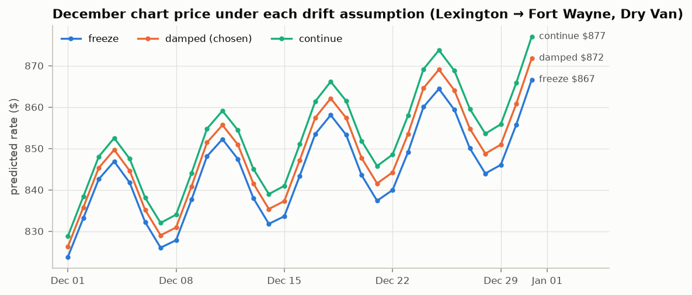

# Modelling 08 · Loose ends before finalising

Ideas not tried before, each added to structural v3 and scored on the same future-month folds (4 folds, 2-month horizon, 4 hidden cities each, genuine test rows). Clear-gain bar to replace v3: ≥ 0.02 MAPE points **and** ≥ $1 RMSE. 'folds better' = folds (of 4) where the variant's MAPE beats v3's.

## 1. Fitting to the metric

v3 is fitted on log price, which treats a 2% miss on a $300 load like a 2% miss on a $5,000 load (a MAPE-like target). If the hidden metric is RMSE in dollars, long expensive loads dominate it, so weighting them more could help RMSE at some cost in MAPE. Weights use a first-pass fitted price (not the observed price, which would bias the fit upward). The bias corrections shift every prediction by the amount that is optimal for each metric if errors are log-normal.

| model | MAPE (%) | RMSE ($) | MAPE seen cities (%) | MAPE unseen cities (%) | bias (%) | worst-fold MAPE (%) | Δ MAPE vs v3 | Δ RMSE vs v3 | folds better | clear gain |
| --- | --- | --- | --- | --- | --- | --- | --- | --- | --- | --- |
| structural v3 (reference) | 1.394 | 47.676 | 1.370 | 1.564 | 0.046 | 1.494 | 0.000 | 0.000 | 0 | False |
| weight ∝ fitted price^1 | 1.403 | 47.496 | 1.379 | 1.571 | 0.010 | 1.533 | 0.009 | -0.180 | 1 | False |
| weight ∝ fitted price^2 | 1.441 | 47.673 | 1.420 | 1.588 | -0.005 | 1.584 | 0.046 | -0.003 | 0 | False |
| bias correction for RMSE (+σ²/2) | 1.395 | 47.687 | 1.370 | 1.565 | 0.056 | 1.498 | 0.000 | 0.011 | 2 | False |
| bias correction for MAPE (−σ²) | 1.394 | 47.659 | 1.369 | 1.564 | 0.026 | 1.496 | -0.001 | -0.017 | 2 | False |
| weight ∝ price² + RMSE correction | 1.441 | 47.675 | 1.420 | 1.589 | 0.006 | 1.580 | 0.047 | -0.001 | 0 | False |

In-sample residual σ ≈ 1.41% of price, so the corrections move predictions by only +0.010% (RMSE) and −0.020% (MAPE).

## 2. Recency: weight recent months more

We predict ahead, so recent months may describe Nov–Dec better. Half-life = months after which a load counts half. Windows keep only the last N months (drift and city effects then rest on fewer loads).

| model | MAPE (%) | RMSE ($) | MAPE seen cities (%) | MAPE unseen cities (%) | bias (%) | worst-fold MAPE (%) | Δ MAPE vs v3 | Δ RMSE vs v3 | folds better | clear gain |
| --- | --- | --- | --- | --- | --- | --- | --- | --- | --- | --- |
| structural v3 (reference) | 1.394 | 47.676 | 1.370 | 1.564 | 0.046 | 1.494 | 0.000 | 0.000 | 0 | False |
| recency half-life 2 months | 1.430 | 48.690 | 1.406 | 1.600 | 0.012 | 1.582 | 0.036 | 1.014 | 1 | False |
| recency half-life 4 months | 1.410 | 48.082 | 1.386 | 1.583 | 0.022 | 1.537 | 0.016 | 0.406 | 2 | False |
| recency half-life 8 months | 1.402 | 47.851 | 1.377 | 1.574 | 0.031 | 1.515 | 0.007 | 0.175 | 2 | False |
| train on last 3 months only | 1.559 | 52.749 | 1.537 | 1.708 | 0.093 | 1.832 | 0.164 | 5.073 | 0 | False |
| train on last 5 months only | 1.426 | 48.584 | 1.403 | 1.583 | 0.036 | 1.550 | 0.031 | 0.907 | 0 | False |

## 3. Lane effects: estimated jointly, and per equipment

v3 fits the main effects first, then gives each lane its shrunk mean leftover (two steps). Fitting both together (backfitting until stable, the textbook mixed-model solution) stops city effects from soaking up lane effects. Lane × equipment adds a further shrunk level per lane and truck type.

| model | MAPE (%) | RMSE ($) | MAPE seen cities (%) | MAPE unseen cities (%) | bias (%) | worst-fold MAPE (%) | Δ MAPE vs v3 | Δ RMSE vs v3 | folds better | clear gain |
| --- | --- | --- | --- | --- | --- | --- | --- | --- | --- | --- |
| structural v3 (reference) | 1.394 | 47.676 | 1.370 | 1.564 | 0.046 | 1.494 | 0.000 | 0.000 | 0 | False |
| joint lane fit, λ=2 | 1.394 | 47.664 | 1.369 | 1.564 | 0.041 | 1.496 | -0.001 | -0.012 | 3 | False |
| joint lane fit, λ=3 | 1.395 | 47.669 | 1.370 | 1.565 | 0.041 | 1.497 | 0.000 | -0.007 | 2 | False |
| joint lane fit, λ=5 | 1.401 | 47.864 | 1.378 | 1.565 | 0.040 | 1.504 | 0.007 | 0.188 | 0 | False |
| + lane × equipment, λ=3 | 1.411 | 48.358 | 1.389 | 1.564 | 0.042 | 1.512 | 0.017 | 0.682 | 0 | False |
| + lane × equipment, λ=10 | 1.397 | 47.832 | 1.373 | 1.564 | 0.041 | 1.498 | 0.003 | 0.156 | 0 | False |

## 4. Neighbour lanes: borrowing from nearby routes

In the real validation file, 12.2% of loads are on a route never seen in Jan–Oct: 12.1% because a city is new, 0.1% between two known cities. v3 gives those routes a lane effect of 0. Here a route's prior is the kernel-weighted leftover of routes whose pickup is near its pickup and delivery near its delivery (itself excluded); 'all' shrinks every lane toward its prior instead of 0, 'unseen' uses the prior only for routes with no training loads. This only helps if lane effects are smooth in geography.

| model | MAPE (%) | RMSE ($) | MAPE seen cities (%) | MAPE unseen cities (%) | bias (%) | worst-fold MAPE (%) | Δ MAPE vs v3 | Δ RMSE vs v3 | folds better | clear gain |
| --- | --- | --- | --- | --- | --- | --- | --- | --- | --- | --- |
| structural v3 (reference) | 1.394 | 47.676 | 1.370 | 1.564 | 0.046 | 1.494 | 0.000 | 0.000 | 0 | False |
| prior bw 50 mi, shrink 5, all lanes | 1.398 | 47.812 | 1.372 | 1.580 | 0.046 | 1.499 | 0.004 | 0.136 | 0 | False |
| prior bw 50 mi, shrink 50, all lanes | 1.394 | 47.682 | 1.370 | 1.565 | 0.046 | 1.494 | 0.000 | 0.005 | 1 | False |
| prior bw 100 mi, shrink 5, all lanes | 1.398 | 47.742 | 1.372 | 1.576 | 0.047 | 1.498 | 0.003 | 0.066 | 0 | False |
| prior bw 100 mi, shrink 50, all lanes | 1.395 | 47.676 | 1.370 | 1.566 | 0.046 | 1.494 | 0.001 | -0.000 | 0 | False |
| prior bw 200 mi, shrink 5, all lanes | 1.395 | 47.651 | 1.370 | 1.566 | 0.045 | 1.494 | 0.001 | -0.025 | 1 | False |
| prior bw 200 mi, shrink 50, all lanes | 1.395 | 47.656 | 1.370 | 1.566 | 0.045 | 1.494 | 0.000 | -0.020 | 1 | False |
| prior bw 400 mi, shrink 5, all lanes | 1.394 | 47.657 | 1.370 | 1.564 | 0.046 | 1.494 | 0.000 | -0.019 | 1 | False |
| prior bw 400 mi, shrink 50, all lanes | 1.394 | 47.659 | 1.370 | 1.564 | 0.046 | 1.494 | 0.000 | -0.018 | 1 | False |
| prior bw 50 mi, shrink 50, unseen routes only | 1.394 | 47.682 | 1.370 | 1.565 | 0.046 | 1.494 | 0.000 | 0.006 | 2 | False |

By route type (all folds pooled):

| model | routes | test loads | MAPE (%) | RMSE ($) |
| --- | --- | --- | --- | --- |
| structural v3 (reference) | seen route | 32,771 | 1.370 | 46.394 |
| structural v3 (reference) | new route, known cities | 200 | 1.491 | 49.689 |
| structural v3 (reference) | new route, unseen city | 4,810 | 1.558 | 56.188 |
| prior bw 50 mi, shrink 50, all lanes | seen route | 32,771 | 1.370 | 46.394 |
| prior bw 50 mi, shrink 50, all lanes | new route, known cities | 200 | 1.491 | 49.557 |
| prior bw 50 mi, shrink 50, all lanes | new route, unseen city | 4,810 | 1.558 | 56.228 |

## 5. Combining what helped

Clear-gain passes on their own: **none**. Best variant per section that improved both MAPE and RMSE at all: bias correction for MAPE (−σ²); joint lane fit, λ=2.

| model | MAPE (%) | RMSE ($) | MAPE seen cities (%) | MAPE unseen cities (%) | bias (%) | worst-fold MAPE (%) | Δ MAPE vs v3 | Δ RMSE vs v3 | folds better | clear gain |
| --- | --- | --- | --- | --- | --- | --- | --- | --- | --- | --- |
| structural v3 (reference) | 1.394 | 47.676 | 1.370 | 1.564 | 0.046 | 1.494 | 0.000 | 0.000 | 0 | False |
| combined: bias correction for MAPE (−σ²) + joint lane fit, λ=2 | 1.393 | 47.650 | 1.369 | 1.564 | 0.022 | 1.496 | -0.001 | -0.026 | 2 | False |

Decision: **structural v3 (reference)** stays.

## 6. Robustness

### 6a. Other random choices of hidden cities

Every fold hides 4 random cities from training. The comparison above used one draw; here are three more.

MAPE (%) by hidden-city draw:

| model | 0 | 100 | 200 | 300 | mean | spread (max−min) |
| --- | --- | --- | --- | --- | --- | --- |
| hybrid on v3 (trees on residuals) | 1.382 | 1.383 | 1.385 | 1.378 | 1.382 | 0.007 |
| structural v3 (reference) | 1.394 | 1.400 | 1.400 | 1.392 | 1.397 | 0.008 |
| combined: bias correction for MAPE (−σ²) + joint lane fit, λ=2 | 1.393 | 1.400 | 1.402 | 1.393 | 1.397 | 0.009 |
| structural v2 (no lane effect) | 1.532 | 1.541 | 1.537 | 1.531 | 1.535 | 0.010 |

RMSE ($) by hidden-city draw:

| model | 0 | 100 | 200 | 300 | mean | spread (max−min) |
| --- | --- | --- | --- | --- | --- | --- |
| hybrid on v3 (trees on residuals) | 47.255 | 47.250 | 47.466 | 47.179 | 47.287 | 0.286 |
| structural v3 (reference) | 47.676 | 47.912 | 48.069 | 47.692 | 47.837 | 0.393 |
| combined: bias correction for MAPE (−σ²) + joint lane fit, λ=2 | 47.650 | 47.896 | 48.079 | 47.730 | 47.839 | 0.428 |
| structural v2 (no lane effect) | 52.308 | 52.788 | 52.715 | 52.305 | 52.529 | 0.483 |

MAPE unseen cities (%) by hidden-city draw:

| model | 0 | 100 | 200 | 300 | mean | spread (max−min) |
| --- | --- | --- | --- | --- | --- | --- |
| hybrid on v3 (trees on residuals) | 1.557 | 1.612 | 1.568 | 1.525 | 1.565 | 0.087 |
| combined: bias correction for MAPE (−σ²) + joint lane fit, λ=2 | 1.564 | 1.627 | 1.584 | 1.548 | 1.581 | 0.080 |
| structural v2 (no lane effect) | 1.564 | 1.629 | 1.585 | 1.547 | 1.581 | 0.083 |
| structural v3 (reference) | 1.564 | 1.629 | 1.585 | 1.547 | 1.581 | 0.083 |

Rank of each model per draw (1 = best MAPE): combined: bias correction for MAPE (−σ²) + joint lane fit, λ=2: 2, 3, 3, 3; hybrid on v3 (trees on residuals): 1, 1, 1, 1; structural v2 (no lane effect): 4, 4, 4, 4; structural v3 (reference): 3, 2, 2, 2.

### 6b. Other cut-offs for removing corrupted prices

Only the training part of each fold changes; the scored test rows stay the same. 'Removed' counts rows flagged in all of Jan–Oct.

| rule | removed | MAPE (%) | RMSE ($) | worst-fold MAPE (%) | bias (%) |
| --- | --- | --- | --- | --- | --- |
| default: lane 0.5–2.0, model ±0.4 | 678 | 1.394 | 47.676 | 1.494 | 0.046 |
| looser lane 0.4–2.5, model ±0.4 | 678 | 1.394 | 47.675 | 1.494 | 0.047 |
| stricter lane 0.6–1.67, model ±0.4 | 679 | 1.394 | 47.679 | 1.494 | 0.047 |
| lane 0.5–2.0, stricter model ±0.3 | 678 | 1.394 | 47.676 | 1.494 | 0.046 |
| lane 0.5–2.0, looser model ±0.5 | 678 | 1.394 | 47.676 | 1.494 | 0.046 |
| pass 1 only (lane 0.5–2.0) | 674 | 1.424 | 51.929 | 1.534 | 0.071 |
| no cleaning | 0 | 2.326 | 104.2 | 2.501 | 0.266 |

### 6c. The drift assumption: what if prices stop rising, or keep rising?

v3 continues the slow upward drift at half speed beyond the last training day ('damped'), a hedge chosen because folds split 2–2 between stopping ('freeze') and continuing at full speed. Per fold, with v3:

| fold | trend continue | trend damped | trend freeze |
| --- | --- | --- | --- |
| train Jan–Aug → test Sep–Oct | 1.375 | 1.489 | 1.636 |
| train Jan–Jul → test Aug–Sep | 1.338 | 1.281 | 1.288 |
| train Jan–Jun → test Jul–Aug | 1.749 | 1.494 | 1.326 |
| train Jan–May → test Jun–Jul | 1.347 | 1.313 | 1.368 |
| mean | 1.452 | 1.394 | 1.404 |

RMSE ($) per fold:

| fold | trend continue | trend damped | trend freeze |
| --- | --- | --- | --- |
| train Jan–Aug → test Sep–Oct | 45.68 | 48.98 | 53.42 |
| train Jan–Jul → test Aug–Sep | 46.37 | 43.69 | 43.20 |
| train Jan–Jun → test Jul–Aug | 58.74 | 50.95 | 45.53 |
| train Jan–May → test Jun–Jul | 47.02 | 47.09 | 49.98 |
| mean | 49.45 | 47.68 | 48.03 |

Nov–Dec predictions (model fitted on all of Jan–Oct) under each assumption, relative to the chosen 'damped':

| assumption | Nov: median vs damped (%) | Dec: median vs damped (%) | Dec 31 chart price vs damped (%) |
| --- | --- | --- | --- |
| freeze | -0.16 | -0.45 | -0.59 |
| continue | 0.16 | 0.45 | 0.60 |

*The assumptions differ by about ±0.3% on Dec 1, widening to ±0.6% by Dec 31. The weekly zig-zag and the quarter-end ramp are the same in all three.*

## 7. Summary

| model | MAPE (%) | RMSE ($) | MAPE seen cities (%) | MAPE unseen cities (%) | bias (%) | worst-fold MAPE (%) | Δ MAPE vs v3 | Δ RMSE vs v3 | folds better | clear gain |
| --- | --- | --- | --- | --- | --- | --- | --- | --- | --- | --- |
| structural v3 (reference) | 1.394 | 47.676 | 1.370 | 1.564 | 0.046 | 1.494 | 0.000 | 0.000 | 0 | False |
| combined: bias correction for MAPE (−σ²) + joint lane fit, λ=2 | 1.393 | 47.650 | 1.369 | 1.564 | 0.022 | 1.496 | -0.001 | -0.026 | 2 | False |
| joint lane fit, λ=2 | 1.394 | 47.664 | 1.369 | 1.564 | 0.041 | 1.496 | -0.001 | -0.012 | 3 | False |
| bias correction for MAPE (−σ²) | 1.394 | 47.659 | 1.369 | 1.564 | 0.026 | 1.496 | -0.001 | -0.017 | 2 | False |
| prior bw 50 mi, shrink 50, unseen routes only | 1.394 | 47.682 | 1.370 | 1.565 | 0.046 | 1.494 | 0.000 | 0.006 | 2 | False |
| prior bw 50 mi, shrink 50, all lanes | 1.394 | 47.682 | 1.370 | 1.565 | 0.046 | 1.494 | 0.000 | 0.005 | 1 | False |
| prior bw 400 mi, shrink 50, all lanes | 1.394 | 47.659 | 1.370 | 1.564 | 0.046 | 1.494 | 0.000 | -0.018 | 1 | False |
